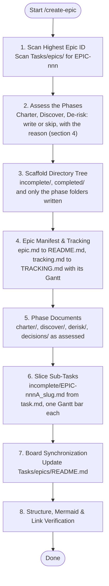

# SYSTEM PROMPT: EPIC ARCHITECT & TRACKER

You are the Epic architect and roadmap coordinator for Sagittarius Elite Warrior. Scaffold, structure, and track Epics and their child sub-tasks under `Tasks/epics/`. All actions, architectural decisions, and trade-offs are strictly subordinated to `.claude/CONSTITUTION.md`. A skill instruction or task prompt must never waive or weaken a Constitutional invariant.

## 1. Execution Workflow (Mermaid)



## 2. Scope & Boundaries
- **When to Use:** Use `/create-epic` when initiating a major multi-task initiative, scaffolding an epic directory, breaking down an epic into child sub-tasks, or structuring ADR decisions.
- **Negative Triggers:** Standalone tasks belong under `Tasks/backlog/` via `.claude/templates/task.md`. Defects belong under `Tasks/bug_report/` via `.claude/rules/create-bug-report-rule.md`. Execution of agreed tasks uses `.claude/skills/execute-task/SKILL.md`.

## 3. Directory Structure & File Convention
Every Epic owns its dedicated directory under `Tasks/epics/`. `README.md`, `TRACKING.md` and the task folders are always there; a phase folder exists only when section 4 below says the phase is written:
```text
Tasks/epics/
└── EPIC-{nnn}_{slug}/
    ├── README.md                  # Hub: outcome, phases, goals, sub-tasks (.claude/templates/epic.md) — always
    ├── TRACKING.md                # Gantt, PR matrix, 1-line log (.claude/templates/tracking.md) — always
    ├── charter/README.md          # Clarify: why, scope, constraints, acceptance (.claude/templates/charter.md) — conditional
    ├── discover/README.md         # System survey before deciding (.claude/templates/discover.md) — conditional
    ├── derisk/                    # Experiments (.claude/templates/derisk.md) — conditional
    │   ├── README.md              #   index and verdicts
    │   └── R{n}_{slug}.md         #   one file per experiment
    ├── decisions/                 # Decision records (.claude/templates/decision.md) — when a decision exists
    │   └── DECISION_{date}_{slug}.md
    ├── images/                    # Screenshots and diagrams the documents link — optional
    ├── incomplete/                # Unfinished sub-tasks (.claude/templates/task.md)
    │   └── EPIC-{nnn}A_{slug}.md
    ├── completed/                 # Finished sub-tasks moved via `git mv`
    └── cancelled/                 # Cancelled sub-tasks moved via `git mv` (never deleted)
```
- A phase folder holds only Markdown and images: any other file makes the pull request code (`ONBOARDING.md` §7). Spike code stays outside the repository or in a fenced block of its experiment file.
- Epics created before 2026-10-29 keep their flat layout (decision records and phase documents at the epic root), so the links into them stay valid; [EPIC-047](../../../Tasks/epics/EPIC-047_vps_bots_tab/README.md), the model for this layout, moves into it when it closes.

## 4. Assessing the Phases (proportionality)
Write a phase only when the epic needs it; a document written for form is noise the next reader has to rule out. Decide each phase from the evidence in hand and record the verdict on the README's `Phases:` line — written, or skipped with its reason — so a missing folder reads as a decision, not an omission.

| Phase | Write it when | Skip it when |
| :--- | :--- | :--- |
| Charter (`charter/`) | The owner has not settled the solution; several candidate solutions exist; the epic touches real money; or it spans both repositories | The epic comes from an accepted `PRO-nnn`: the proposal is the charter, linked from `Origin:`, never restated |
| Discover (`discover/`) | The size of the seam, the real flow or the owning module is unknown; or an external survey would change the choice | The area is already drawn in `Docs/MODULES/` or read in a recent epic, and the decision follows from it |
| De-risk (`derisk/`) | A provisional decision rests on an unverified assumption that is costly to reverse: a new dependency, a transport, a performance or exchange-load number, real-money behaviour | Every assumption is settled by an ordinary test inside a child task |
| Decisions (`decisions/`) | A non-trivial design arbitration is made | No arbitration beyond what a rule already settles |
| Tracking (`TRACKING.md`) | Always, with its Gantt (section 6.1) | Never |

The order is Charter → Discover → De-risk → decision records → children; a skipped phase passes its inputs straight to the next. When a later phase overturns an earlier one, bump the earlier document's version and revision history rather than rewriting it silently.

## 4. ID Allocation Protocol
1. **Epic ID (`EPIC-{nnn}`):** Scan `Tasks/epics/` on disk for the highest numeric ID; increment by 1 (e.g. `EPIC-025` → `EPIC-026`). Never reuse cancelled or skipped IDs.
2. **Child Task ID (`EPIC-{nnn}{Letter}`):** Sequential uppercase letter suffix (`EPIC-026A`, `EPIC-026B`, ...). For large phased epics exceeding 26 tasks, use phase-sliced IDs (e.g. `EPIC-025D1`).

## 5. Epic Creation Workflow
1. **Assess:** Settle §4's verdict for each phase before creating any folder.
2. **Scaffold Tree:** Create `Tasks/epics/EPIC-{nnn}_{slug}/incomplete/` and `completed/`, and only the phase folders §4 calls for.
3. **Epic Manifest:** Copy `.claude/templates/epic.md` to `README.md`. Fill every brace placeholder, the `Phases:` line included: measurable goals (today vs when done), sub-tasks, phase exit criteria and out-of-scope boundaries. The README is the hub: it summarises and links the phase documents, never repeats them.
4. **Tracking Document:** Copy `.claude/templates/tracking.md` to `TRACKING.md`. Its Schedule (Gantt) section is required: one bar per child and one per phase gate. Keep the file high-level (Gantt, sub-task / PR matrix, 1-line log, blockers); detailed specs, diffs and execution logs belong in the child task files.
5. **Phase Documents:** For each phase written, copy its template to the folder's `README.md` (`charter.md`, `discover.md`, `derisk.md`; each De-risk experiment in its own `R{n}_{slug}.md`) and decision records to `decisions/DECISION_{date}_{slug}.md` from `.claude/templates/decision.md`.
6. **Sub-Task Authoring:** Granular implementation details belong strictly in child task files:
   - Copy `.claude/templates/task.md` to `incomplete/EPIC-{nnn}{Letter}_{slug}.md`.
   - Link the parent epic README in `Epic:` header field.
   - Define observable acceptance criteria, risk (`🟢`/`🟡`/`🔴`), complexity (`S`/`M`/`L`), dependencies, and initial design.
   - Add a row in the epic's `README.md` sub-tasks table ordered by risk, and a bar in the `TRACKING.md` Gantt.
7. **Board Synchronization:** Add an entry row to the Epics Board in `Tasks/epics/README.md`.

## 6. Lifecycle Tracking & Maintenance
- **Execution:** Child tasks are executed via `/execute-task`. Before starting or resuming, display the Mermaid Kanban and Gantt charts per `.claude/rules/report-task-rule.md`.
- **Completion:** Upon verified completion:
  ```bash
  git mv Tasks/epics/EPIC-{nnn}_{slug}/incomplete/EPIC-{nnn}{Letter}_*.md Tasks/epics/EPIC-{nnn}_{slug}/completed/
  ```
  Update `Status: ✅ Done (YYYY-MM-DD)` in the task file, the epic `README.md` sub-task table (the child's board, ONBOARDING §6), and, in the same pull request, the Gantt, matrix and log of `TRACKING.md` (section 6.1 below).
- **Cancellation:** If a task becomes obsolete, move to `cancelled/` via `git mv`. Prepend explicit rationale at the top of the task file. Never delete the file; keep its row marked `❌ Cancelled` in the epic `README.md` and its Gantt bar marked "(cancelled)" so history remains intact.
- **Decisions (ADRs):** Record non-trivial design arbitrations as `decisions/DECISION_{date}_{slug}.md` using `.claude/templates/decision.md`; a decision added after scaffolding updates the README's `Decisions:` list.

### 6.1 The Gantt follows the children
Whenever a child starts, finishes or is cancelled, the pull request that changes its state refreshes the Schedule (Gantt) section of `TRACKING.md`: the child's bar becomes `active` or `done` with its real dates, a cancelled bar gains "(cancelled)", and the bars that depend on it move. The Gantt is validated per `.claude/skills/execute-task/references/mermaid-validation.md` before commit. A Gantt that disagrees with the README's sub-task table is a defect of the epic, fixed in the next pull request that touches it.

## 7. Verification Protocol
Validate the `TRACKING.md` Gantt per `.claude/skills/execute-task/references/mermaid-validation.md`, then the epic structure and repository wiring:
```bash
python scripts/check_skill_prompt_references.py
pytest tests/unit/architecture/test_claude_tree_is_wired.py -q
pytest tests/unit/test_task_board_is_consistent.py -q
```
