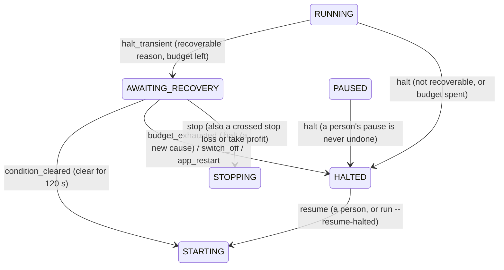

Status: Current

# 001 — Layered policy and a lifecycle state for halt recovery

Teaches the design of ADR 042, `Tasks/epics/EPIC-042_halt_auto_recovery/DECISION_2026-10-17_halt_auto_recovery.md`, designed in [PR #546](https://github.com/anhembedded/Sagittarius_Elite_Warrior/pull/546) (merged 2026-10-17). `EPIC-042B` built the state, the layers and the ledger, and `EPIC-042C` the halt that uses them: the director, the probe and the recovery run (`bots/application/services/lifecycle/halt_recovery_director.py`, `bots/application/kinds/grid/recovery/grid_halt_recovery.py`). The alerts (`EPIC-042D`) and `run --resume-halted` (`EPIC-042E`) are still design. Update this page when they land.

## 1. The problem

On 2026-10-17 a Spot mainnet grid bot on the headless VPS heard no price tick for more than 60 s and halted with `price_feed_stale`. Within minutes the feed was healthy again (the host's health line read `tick_age_s=1`), but the bot stayed `HALTED`.

Two things made this costly:

- In the bot lifecycle, a `HALTED` bot leaves only through a person's Resume or a Stop.
- The headless host had no way for that person to Resume it.

So every network blip of more than a minute parked a real-money bot until someone logged in, and the bought base sat unprotected in the meantime.

## 2. Constraints

- **Real money.** Recovery must never re-lay a ladder blindly. If the price crossed the stop loss or the take profit while the feed was down, the bot must end, not continue.
- **No loops.** A feed that keeps failing must not make the bot re-enter the market forever.
- **Never undo a person.** A bot the owner paused stays paused.
- **Several bot kinds and venues.** Futures halts close the position, so they must not auto-recover yet. Spot halts keep the base, so they may.
- **One operator, often asleep.** Every automatic action raises an alert.

## 3. Solutions considered

| Option | For | Against |
| :--- | :--- | :--- |
| A flag on `HALTED` plus an `if` in the resume path | Smallest diff | Every reader of `HALTED` (UI rules, alerts, the restart rule) must remember the flag, and no test fails when one forgets. The owner rejected it. |
| Reuse the existing `RECOVERING` state | No new state | `RECOVERING` already means "a restart is reconciling". Two meanings in one name is the classic source of state-machine bugs. |
| **A new state `AWAITING_RECOVERY` with its own events** | Every consumer answers for it through the transition table, and a forgotten case is a refused transition, not a silent bug | One more state, with rows in the table and the generated docs |
| Retry in a loop inside the halt handler | No lifecycle change | Invisible to the UI and alerts, untestable as a state, and it survives nothing (a restart forgets it) |

For *which* reasons are recoverable:

| Option | For | Against |
| :--- | :--- | :--- |
| Class inheritance (`SpotGridPolicy(GridPolicy, SpotPolicy)`) | Familiar | Two axes (kind × venue) need a class per pair. The method resolution order decides who wins, out of sight. An override cannot be listed or printed. |
| One flat table per (kind, venue) pair | Explicit | The shared reasons are copied into every pair and drift apart. |
| **Layers of plain data, merged in a fixed order** | Shared reasons written once; each layer adds, removes or tunes; the merged table is printable and testable | Needs one small, well-tested merge function |

## 4. The choice and why

**A real state plus layered data.**

The state turns "is this bot waiting to recover?" into something the finite-state machine enforces. A transition the table does not list is refused, so a pause can never be undone by mistake: `PAUSED` has no `halt_transient` cell.

The layers turn "which reasons, how long, how often" into data. Opening Futures later deletes one line, and adding a reason adds one entry.

## 5. How it is implemented (design)

The state and its three new events, from the ADR's §2.1 (a long wait never ends the state by itself):



The policy is three layers of frozen data, folded common → kind → venue. A later layer wins:

```python
COMMON  = RecoveryLayer("common", changes={
    "price_feed_stale": RuleChange(),       # default rule: dwell 120 s, 3 per 24 h, stalled alert after 15 min
    "user_stream_down": RuleChange(),
})
GRID    = RecoveryLayer("grid")             # empty today; rate_limited joins in EPIC-042F
SPOT    = RecoveryLayer("spot")             # keeps the common set
FUTURES = RecoveryLayer("futures", clears_lower_layers=True)   # nothing recovers yet

def effective_policy(*layers):
    table = {}
    for layer in layers:                    # order is the precedence
        if layer.clears_lower_layers:
            table.clear()
        for code in layer.withdrawn:
            table.pop(code, None)
        for code, change in layer.changes.items():
            table[code] = change.apply(table.get(code, DEFAULT_RULE))
    return table
```

The same function feeds the decision-maker (`HaltRecoveryDirector`) and `bot show`. What the bot obeys is therefore exactly what the owner can print.

The attempt history (`BotLifecycle.recovery_attempts`) is saved in the bot file, so a restart keeps the 24-hour budget. An attempt is counted when it **starts**, so a crash between the two halves of a resume cannot hand out free retries.

## 6. Risks and failure modes

- **A flapping feed.** The budget is three attempts per rolling 24 h per bot, whatever the reasons. After that a person decides.
- **A feed that never returns.** The bot keeps waiting, because it is exactly as exposed as a `HALTED` one and a long outage should still recover by itself. But a wait is silent (no entry into `HALTED`, so no alert), so after 15 minutes it raises one `BOT_RECOVERY_STALLED` warning and goes on waiting. The owner chose this over a limit that would turn a 20-minute outage into a manual case.
- **A price that crossed the stop and came back while the feed was down.** No tick was heard, so nothing can see it. A person's Resume has the same blind spot. The ADR states this rather than hiding it.
- **A restart during the wait.** It goes to `HALTED`, because a fresh process has its order session closed and could not complete the resume.

## 7. Limits

- The dwell is measured on one process's clock. It is not a distributed consensus about "the network is healthy".
- A reason is transient only when a probe can *observe* that it cleared. Maintenance windows (`symbol_not_trading`) need evidence first, so they are not declared.
- The budget is per bot, not per reason. That is the conservative reading of the owner's rule, and it is slower to recover when two different causes strike in one day.

## 8. Names to know

- **Finite-state machine (FSM)** with an explicit transition table: "illegal states unrepresentable".
- **Composition over inheritance**; **layered (cascading) configuration**, as in CSS cascade, `.gitconfig` system → global → repo, and Kustomize overlays.
- **Retry budget** and **exponential backoff**, the classic stability patterns from *Release It!* (Nygard).
- **Dwell time** (debounce or hysteresis): a condition must hold for a while before acting, so the bot does not flap.
- **Idempotent, at-least-once recovery**: count the attempt before acting.
- **Fail-safe default**: when unsure, stop and page a human.

## 9. Interview questions

1. *Why a new state instead of a flag?* A flag is invisible to code that does not check it. A state is enforced by the transition table: an unlisted transition is refused, so forgetting a case fails loudly.
2. *How do you stop an auto-recovery from looping?* With a budget (3 per rolling 24 h, persisted) and a dwell (120 s continuously clear). Count the attempt before acting. A long wait is not looped on; it raises one alert.
3. *Why not inheritance for per-kind and per-venue rules?* Two axes produce a class per combination, and the method resolution order hides precedence. Data layers merged in one explicit order are printable and testable.
4. *What happens if the process restarts mid-wait?* The bot goes to `HALTED` with its ledger kept. A restart is not a person's confirmation, and the order session is closed.
5. *What can this design not protect against?* A price that crossed and recovered during the outage with no tick heard. Mitigating that needs an exchange-side stop, which is EPIC-039L for Futures.

## 10. Read more

- Michael Nygard, *Release It!*, 2nd ed., the chapter on stability patterns (timeouts, circuit breaker, steady state).
- Martin Kleppmann, *Designing Data-Intensive Applications*, chapter 8, "The Trouble with Distributed Systems".
