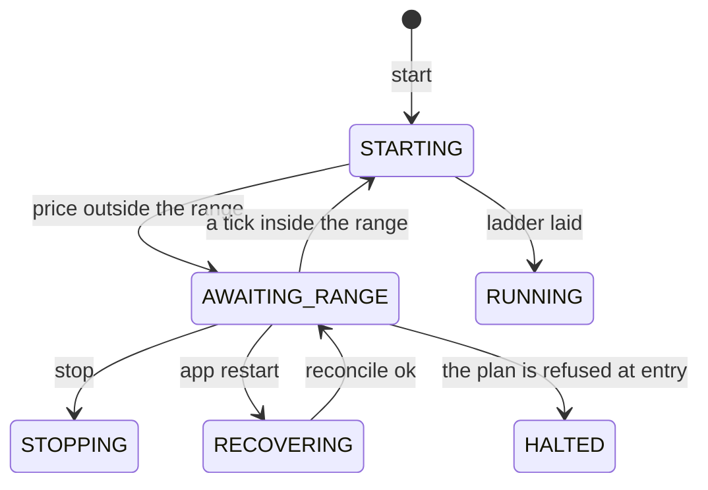

Status: Current

# 004 — Waiting is a state: a bot that has started but may not trade yet

Teaches the design of ADR 044, `Tasks/epics/EPIC-044_grid_waits_for_the_range/DECISION_2026-10-21_a_grid_waits_for_the_range.md` (proposed in the epic's first pull request; this page describes the proposal and is updated when it is built, `EPIC-044B`).

## 1. The problem

A grid bot trades inside a price range the owner chose. Until now what happened when the owner started it with the price *outside* that range depended on the side and ignored the bot's direction. The worst case: a SHORT bot started above its range planned a market short of the whole capital (0.1542 BTC, about 10 950 USDT in the probe) before it placed a single order, while the screen said it "places BUY orders only". The owner's rule replaced all of it: the bot starts, places nothing, waits for the price to be inside the range, then does exactly what a normal start would do.

## 2. Constraints

- **Real money, both directions.** The rule is the same for LONG, SHORT and NEUTRAL, Spot and Futures.
- **Nothing is held while waiting**, so a stop loss has nothing to protect and Stop must work at once.
- **A restart must never trade.** A process that comes back after a crash may not lay a ladder on its own.
- **Truthful display.** If the screen says "waiting", something must be watching the price.
- **A backtest must agree with the live bot**, or it teaches the wrong thing.

## 3. Solutions considered

| Option | For | Against |
| :--- | :--- | :--- |
| A flag on `RUNNING` ("waiting: true") | no new state | every code path that reads `RUNNING` must learn the flag (17 files here); easy to miss one |
| Stay in `STARTING` | no new state | `STARTING` means "an order may be half-sent", and a restart treats it as an interrupted start |
| **A state of its own, `AWAITING_RANGE`** | the transition table says what a waiting bot may do; derived sets follow | one more state to classify in every hand-written set |
| Refuse the start until the price is inside | trivial | there is nothing to stop, to alert on, or to see |

## 4. The choice and why

A state of its own. The table of transitions is the one place that answers "what can happen to a bot that is waiting?", and the tests can enumerate the answer. The same shape already exists for a halt a machine may heal (`AWAITING_RECOVERY`, page 001).

## 5. How it is implemented

Entry reuses the start sequence unchanged: the same code that lays a ladder at Start lays it at entry, on the price read then. The decision "inside" uses `range_position` (`bots/domain/grid/range_position.py`), the one definition the running bot's range watch already uses, and the price source of the exits: the mark price on Futures, the last trade on Spot.

## 6. Risks and failure modes

- A price that flickers across a bound: the plan's own price is re-read before any order and the bot goes back to waiting if it is outside again.
- A plan that would be refused at entry (not enough balance, an order under the exchange minimum): the bot halts and says why; it does not wait for ever on something no tick can fix.
- A feed that is down: no tick, no entry. The existing feed alert says so.

## 7. Limits

A wait has no time limit, by the owner's choice. A wait that should end by itself (a dwell, a deadline) is a separate rule on top of the same state.

## 8. Names to know

Finite-state machine; state versus flag (a "boolean trap" on a state); guard condition on a transition; level-triggered versus edge-triggered entry; hysteresis; idempotent restore; truthful UI.

## 9. Interview questions

1. *Why a new state rather than a flag on the running state?* Because the state machine is the contract; a flag makes every reader of the state responsible for remembering it.
2. *What does a restart do to a waiting bot, and why not simply keep waiting?* It goes through the same reconcile as a running bot: the lease and the order session are per process, and a "waiting" label with nothing watching the price would be false.
3. *Level-triggered or edge-triggered entry?* Level: the bot enters when the price *is* inside, including a start inside the range; an edge trigger would miss a price that was already inside.
4. *Why is the plan's price re-read after the tick said "inside"?* Two sources (mark and book) can disagree by a few basis points at the edge; deciding on the exit's source and confirming on the planner's costs one read and avoids an order at a price the plan treats as outside.

## 10. Read more

- Harel, *Statecharts: a visual formalism for complex systems* (1987) — hierarchical states and why a flag is not a substate.
- Fowler, *PatternsOfEnterpriseApplicationArchitecture*, "Special Case" and "State" — modelling a mode as an object, not a boolean.
