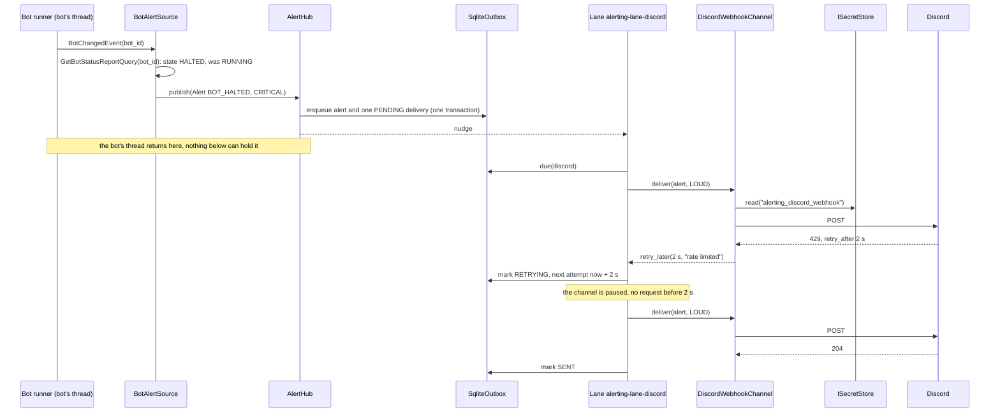

Status: Current

# `alerting` — the module that carries an alert to the owner when the owner is away

**Reader:** someone building the next alerting task (`EPIC-036`), adding a channel or an alert
source, or deciding whether the headless host can be left alone with real money.
**Question it answers:** *when something the owner must know happens, how does it reach them, once,
even if a channel is down, the platform asks us to wait, or the app restarts?*

Each fact below is marked **Built** (on `master-warrior`, delivered by `EPIC-036A` and the walking
skeleton `EPIC-036G`, cited `file:line`) or **Planned** (designed here, not written; the task that
builds it is named). The design of record
was [design 036](../../Tasks/epics/EPIC-036_alerting_module/DESIGN_2026-10-08_alerting_module.md)
(2026-10-08); this document replaces it as the module's current design. The decisions behind the
module are [ADR 036 N1–N8](../../Tasks/epics/EPIC-036_alerting_module/DECISION_2026-10-08_alerting_module.md)
and [ADR 036 of 2026-10-15](../../Tasks/epics/EPIC-036_alerting_module/DECISION_2026-10-15_walking_skeleton_and_headless_secrets.md)
(Discord first, the walking skeleton first, where a channel's secret comes from on a headless host).
The research is [research 036](../../Tasks/epics/EPIC-036_alerting_module/RESEARCH_2026-10-08_alerting_lessons.md).
The template is [`README.md`](README.md). Paths are from the repository root; `alerting/` means
`src/modules/alerting/`.

## 1. Context

**Built.** `alerting/module.py:83` declares `dependencies = ["bots"]`: the module reads
`bots/contracts` only — `BotChangedEvent` (`src/modules/bots/contracts/events/bot_changed_event.py:11-29`),
`BotStopGaveUpEvent` (`src/modules/bots/contracts/events/bot_stop_gave_up_event.py:17`, published by
`grid_stop_retry.py:117-132`) and the one-bot read `GetBotStatusReportQuery(bot_id)`
(`src/modules/bots/contracts/bot_status_report.py:51-69`) — and no context imports its insides, so a
new kind of bot changes nothing here (N1). The shell lists `AlertingModule` with the other modules
(`src/shell/modules.py:41,55`). What crosses its edge:

- in: `IAlertPublisher` (`publish`, `condition_cleared`, `alerting/contracts/i_alert_publisher.py:11-24`),
  called by the module's own bot source today and by every source `EPIC-036B` adds;
- out: one `IAlertChannel.deliver(alert, loudness) -> DeliveryResult` per configured channel
  (`alerting/contracts/i_alert_channel.py:34-42`); the one channel is Discord, over
  `IWebhookTransport` (`alerting/contracts/i_webhook_transport.py:59`), with its webhook read by name
  through `ISecretStore` (`src/core/contracts/i_secret_store.py:24-38`);
- asked: `IAlertingStatus.carries_bot_events()` (`alerting/contracts/i_alerting_status.py:14`).
  `operations` binds `AlertingAlertChannels` over it (`src/modules/operations/adapters/alerting_alert_channels.py:19`,
  `src/modules/operations/module.py:150,163`), so `run` warns "nothing will tell you if a bot halts"
  (`src/modules/operations/application/host_steps.py:64-77`) only when no channel is configured;
- the `alert` command-line command (`alerting/module.py:90-96`) and the `alerting` section of the
  health snapshot (`alerting/module.py:98-109`).

The boundary guards under `tests/unit/architecture/boundaries/` hold the direction: `bots` and
`trading` never import `alerting`. A module's `composition/` may import `support/secrets`, where the
secret stores live (`tests/unit/architecture/boundaries/rules.py`, `_SECRETS_SUPPORT_ZONES`).

**Planned.** `EPIC-036B` adds `trading/contracts` (`UserStreamHealthEvent`) and the system
failures; `EPIC-036F` adds the receive side, `IRemoteCommandSource`, which is not an `IAlertChannel`.

## 2. Components

**Built.** An alert's path, in classes:

- **`AlertHub`** (`alerting/application/alert_hub.py:80`) is the publisher. `publish` runs on the
  caller's thread and only writes the outbox (`:108-110`, `:205-246`): in order it **inhibits**
  through `ConditionBook` (`condition_book.py:95-109`), **deduplicates** through `AlertDeduplicator`
  (`alert_deduplicator.py:38-46`), **holds** INFO and WARNING in quiet hours through `QuietHoursHold`
  (`quiet_hours_hold.py:29-40`), **groups** one kind and venue through `AlertCoalescer`
  (`alert_coalescer.py:49-65`), then **routes** through `AlertRouter` (`alert_router.py:32-71`) and
  **admits** each target to its channel's bounded queue through `DeliveryAdmission`
  (`delivery_admission.py:26-45`). It is also the worker's one door back, `IDeliveryFollowUp`
  (`channel_failing`, `fail_over`, `alert_hub.py:160-201`).
- **`SqliteOutbox`** (`alerting/adapters/sqlite_outbox.py:92`) implements `IOutbox`
  (`alerting/contracts/i_outbox.py:30-97`): the transactional outbox, at-least-once.
- **`ChannelDelivery`** (`alerting/application/channel_delivery.py:48`) is one worker pass over one
  channel, with no thread of its own (`run_due`, `:68-90`); **`ThreadedDeliveryHost`**
  (`alerting/adapters/threaded_delivery_host.py:37`) runs it on a lane per channel.
- **`RegisteredChannelCatalog`** (`alerting/adapters/registered_channel_catalog.py:15`), built from
  `CHANNEL_DESCRIPTORS` (`alerting/composition/channel_bindings.py:31-55`), is the one list a channel
  is added to. The test double is `FakeAlertChannel` (`alerting/contracts/testing/fake_alert_channel.py:35`).
- **`InMemoryAlertSettings`** (`alerting/adapters/memory_alert_settings.py:21`) holds N4's defaults
  behind `IAlertSettingsSource`; `NullAlertPublisher` stands in on a read-only copy
  (`alerting/composition/alerting_bindings.py:97-104`); `AlertingHealthContributor`
  (`alerting/application/alerting_health_contributor.py:31`) reports the backlog.

The walking skeleton (`EPIC-036G`) added:

- **`BotAlertSource`** (`alerting/application/sources/bot_alert_source.py:86`), the anti-corruption
  layer at the edge: `on_bot_changed` reads the bot and alerts on the *entry* into a state of
  `ALERT_ON_ENTRY` (`:73-76`); `on_stop_gave_up` raises `STOP_FAILED` even when the bot cannot be
  read (`:129-142`); the entry into a state of `CLEARED_ON_ENTRY` (`:78-84`) calls
  `condition_cleared` with the key `Alert.condition_key` gives (`alerting/domain/alert.py:67-71`).
- **`DiscordWebhookChannel`** (`alerting/adapters/discord_webhook_channel.py:46`) joins
  `discord_payload` (`alerting/adapters/discord_message.py:53`) and `result_of`
  (`alerting/adapters/discord_answer.py:41`); it reads `alerting_discord_webhook` at each send
  (`discord_webhook_channel.py:43`, `:51-71`). The transport is **`UrllibWebhookTransport`**
  (`alerting/adapters/urllib_webhook_transport.py:41`); its test double is
  **`FakeWebhookTransport`** (`alerting/contracts/testing/fake_webhook_transport.py:36`), and both pass
  one contract suite (`alerting/contracts/testing/contract_webhook_transport.py`).
- **`discord_channel`** (`alerting/composition/channel_bindings.py:65-85`), the descriptor's factory:
  it answers `None` when no webhook, or no Discord webhook URL, is stored, so an unconfigured
  channel is not in the catalog and starts no lane (`:93-109`). Its secrets come from
  `ChannelSecrets` (`:58-62`), bound to `build_secret_stores()` of `support/secrets`
  (`alerting_bindings.py:105-107`).
- **`ChannelAlertingStatus`** (`alerting/application/channel_alerting_status.py:16`): a channel is
  carried when it is in the catalog and not disabled.
- **`SendTestMessage`** (`alerting/application/send_test_message.py:47`) and **`AlertCliHandler`**
  (`alerting/cli/alert_cli_handler.py:59`): `alert test`, one loud `TEST` alert per channel, straight
  to the channel and never through the outbox (design 036 §9).

Every binding is in `alerting/composition/alerting_bindings.py:98-168`.

**Planned.**

| Class | Where | Task |
| :--- | :--- | :--- |
| `StreamAlertSource`, `SystemAlertSource` (replaces `NotificationEventHandler`) | `alerting/application/sources/` | `EPIC-036B` |
| `TelegramChannel` (moved), the token migration, the embed layout, pacing, `RotateSecret` | `alerting/adapters/`, `alerting/application/` | `EPIC-036C` |
| The Options page, the Alerts dock, the status-bar indicator, the per-bot menu item; a persisted `IAlertSettingsSource` | `alerting/ui/`, `alerting/adapters/` | `EPIC-036D` |
| `HeartbeatService`, the dead man's switch pinger | `alerting/application/`, `alerting/adapters/` | `EPIC-036E` |
| `IRemoteCommandSource`, `RemoteCommandGate` | `alerting/` | `EPIC-036F` |

## 3. State machines

There is no `*_fsm_matrix.py` in the module yet; the one state that is stored is a delivery's,
`DeliveryState` (`alerting/domain/delivery_state.py:8-19`). Until the task that generates this view
(decision D4 of `EPIC-041`) adds a transition table beside the enum, this is the summary, with the
code that moves each edge:

| From | To | When | Where |
| :--- | :--- | :--- | :--- |
| (new) | `PENDING` | routed and admitted | `sqlite_outbox.py:161-178` |
| (new) | `DROPPED` | the channel's queue is full and nothing below this severity can be shed (never a CRITICAL) | `delivery_admission.py:38-45` |
| `PENDING`, `RETRYING` | `SENT` | the channel answered `ok` | `channel_delivery.py:101-107` |
| `PENDING`, `RETRYING` | `RETRYING` | the platform asked to wait (no attempt used), or a failure with attempts left | `channel_delivery.py:116-131` |
| `PENDING`, `RETRYING` | `FAILED` | a permanent refusal, or the last attempt failed; `CHANNEL_FAILING` is raised once | `channel_delivery.py:108-115`, `:121-134` |
| `PENDING`, `RETRYING` | `EXPIRED` | the alert is older than the expiry, at the start of every pass | `channel_delivery.py:77`, `sqlite_outbox.py:224-233` |
| `PENDING`, `RETRYING` | `DROPPED` | shed to make room for a more severe newcomer | `sqlite_outbox.py:253-270` |

`SENT`, `FAILED`, `EXPIRED` and `DROPPED` are final (`DeliveryState.is_open`, `delivery_state.py:16-19`).
A fail-over is not a transition: it adds a new `PENDING` delivery on another channel
(`alert_hub.py:176-201`).

**Built** (`EPIC-036G`): `BotAlertSource` keeps each bot's last seen state in memory and acts on
the *entry* into a state only (`bot_alert_source.py:113-127`), so a rewrite of a halted bot's file is
not a second alert. The lifecycle it reads is `bots`' own table
(`src/modules/bots/domain/bot_lifecycle_fsm_matrix.py:44-55`), never a copy: the states it names are
contract text, and `test_every_state_the_source_names_is_a_lifecycle_state` fails if one is renamed.

## 4. Sequences

**Built: one alert from `publish` to a channel.** `publish` takes the hub's lock, runs the steps of
§2 and writes one alert row and one delivery row per admitted channel in one transaction
(`alert_hub.py:205-246`, `sqlite_outbox.py:126-154`), then nudges the lanes (`WakeSignal`,
`alerting/adapters/wake_signal.py:23-26`). Each lane wakes, expires what is too old, takes the due
delivery of the highest severity and calls the channel outside every lock
(`channel_delivery.py:68-90`, `:149-159`). A wait the platform asks for pauses the whole channel,
not one message, and survives a restart, because the next process reads it back from the open
`RETRYING` rows (`channel_delivery.py:173-185`, `sqlite_outbox.py:235-242`). A CRITICAL left
behind a wait longer than five minutes is queued on another channel (`channel_delivery.py:135-147`).
Grouped alerts and the quiet-hours summary leave from the housekeeping tick, `AlertHub.flush_due`
(`alert_hub.py:139-151`). A source that sees its condition clear calls `condition_cleared`, which
sends one INFO "Recovered" alert and re-arms the key (`alert_hub.py:112-135`).

**Built:** the skeleton journey (a bot halts on the VPS, Discord hears it once) is §8. At boot the
module starts the lanes, subscribes the bot source to both bots events, then seeds it from the bots'
report without alerting (`alerting/module.py:111-125`). **Planned:** Telegram, the Options page's
Send test and the remote command are drawn in design 036 §9 and §11 and are drawn here when
`EPIC-036C`, `036D` and `036F` build them.

## 5. Data model

**Built.** An `Alert` is frozen: kind, severity, subject, title, detail, time (UTC), `dedup_key`
naming the *condition*, and a `recovery` flag (`alerting/domain/alert.py:18-45`); `Alert.raised`
keys it by kind, subject identity and reason (`:46-66`) through `Alert.condition_key` (`:67-71`). The subject is a bot, a venue or the app
(`alerting/domain/alert_subject.py:9-59`); a bot subject carries id, name, kind, venue and symbol,
so a later "stop this bot" can point at the right one. Each `AlertKind`
(`alerting/domain/alert_kind.py:9-30`) has one group, one default severity and one label in
`KIND_PROFILES` (`alerting/domain/alert_catalog.py:31-74`); `TEST` is the Send test's. `AlertSettings` holds disabled channels,
route cells, per-bot modes and quiet hours, and **no secret** (`alerting/domain/alert_settings.py:20-43`).

The outbox is one SQLite file, `<data root>/state/alerts.sqlite3`
(`alerting/composition/alerting_bindings.py:94-95`), schema version 1
(`alerting/adapters/sqlite_outbox.py:49-85`): table `alerts` (the alert's fields plus `count` and
`last_at`, so a repeat is one row with a counter) and table `deliveries` (one row per alert and
channel: loudness, state, attempts, next attempt time, a sanitised reason). A file written by a newer
schema is refused (`sqlite_outbox.py:104-113`). The records that cross the port are in
`alerting/contracts/outbox_records.py:15-76`. Dedup windows, groups, inhibitors and the held
quiet-hours list are in memory and do not survive a restart, on purpose: after a restart a repeat is
heard twice, never zero times (`alert_deduplicator.py:29-32`, `condition_book.py:32-34`).

**Built** (`EPIC-036G`). The skeleton stores nothing new in the outbox. The Discord webhook is a
secret named `alerting_discord_webhook` (`discord_webhook_channel.py:43`), read by name at each send
and never written by the app on a headless host (ADR 036 of 2026-10-15, D3). The per-bot last-seen
state of `BotAlertSource` is in memory and is seeded from the bots' report at boot, without alerting
(`bot_alert_source.py:99-111`).

## 6. Threading and deployment

**Built.** `publish` runs on whichever thread raised the alert and never calls a channel
(`alerting/contracts/i_alert_publisher.py:11-14`). Each channel has its own daemon thread,
`alerting-lane-<channel>`, and one more, `alerting-housekeeping`, runs the flush every second
(`alerting/adapters/threaded_delivery_host.py:33-34`, `:56-72`); a lane that raises logs and carries
on at the next poll (`:94-103`). It is a thread and not an Engine `Scheduler` job because every
scheduled run puts two events on the bus (`threaded_delivery_host.py:3-7`). The outbox is one
connection shared behind a lock, one short transaction per call, WAL journal
(`sqlite_outbox.py:1-10`, `:92-124`). `boot()` starts the lanes and `shutdown()` stops them, then
closes the outbox; what is queued goes out at the next start (`alerting/module.py:111-133`). A second
process on the same data root is read-only (`EPIC-035H`): it opens no outbox, starts no lane,
subscribes no source, and its `IAlertPublisher` is the null one (`alerting/module.py:113-115`,
`alerting_bindings.py:132-139`).

The bot source's handlers run on the thread that wrote the bot (the bus is synchronous); they read
one bot and call `publish`, under one lock (`bot_alert_source.py:113-127`). The Discord call runs on
the lane `alerting-lane-discord`, so a slow Discord never holds a bot; one POST waits at most
`REQUEST_TIMEOUT_S` (`alerting/adapters/urllib_webhook_transport.py:31`). On the headless host
(`deploy/linux/sew-run.service`, generated by `scripts/render_service_files.py`) the webhook arrives
as a systemd credential, `$CREDENTIALS_DIRECTORY/alerting_discord_webhook`
(`deploy/linux/sew-run.service:48`, `scripts/render_service_files.py:91-93`), the route the mainnet
keys take (`src/support/secrets/adapters/systemd_credential_store.py:1-17`); systemd copies it at
start, so a rotated webhook needs a restart (`Docs/OPERATIONS/headless_runbook.md` §3). The
`alert test` verb runs as a second process: it calls the channel directly and writes nothing.

## 7. Timing

**Built.** The constants that decide when an alert is merged, retried, failed over, expired or purged:

| What | Value | Where |
| :--- | :--- | :--- |
| A repeat is the same alert for: CRITICAL; WARNING and INFO | 1 min; 15 min | `alerting/domain/alert_policies.py:16-17` |
| Same kind and venue are grouped within | 10 s | `alerting/domain/alert_policies.py:18` |
| A venue-down alert stops hiding its bots' alerts after | 1 h | `alerting/domain/alert_policies.py:21` |
| Attempts before a delivery fails; back-off from, doubling, capped at | 5; 5 s; 5 min | `alerting/domain/alert_policies.py:33-35`, `:45-48` |
| A CRITICAL fails over when the channel asks to wait longer than | 5 min | `alerting/domain/alert_policies.py:37` |
| An alert older than this expires instead of being sent | 24 h | `alerting/domain/alert_policies.py:39` |
| Queue per channel (CRITICAL is admitted beyond it) | 200 | `alerting/domain/alert_policies.py:41` |
| Finished alerts are kept for; purged every | 30 days; 1 h | `alerting/domain/alert_policies.py:43` · `alerting/application/alert_hub.py:77` |
| A lane looks at the outbox unprompted every; housekeeping runs every | 5 s; 1 s | `alerting/composition/alerting_bindings.py:88`, `:91` |
| One webhook POST counts as no answer after | 10 s | `alerting/adapters/urllib_webhook_transport.py:31` |
| A 429 that names no wait waits | 5 s | `alerting/adapters/discord_answer.py:36` |
| `stop()` waits for a lane stuck inside a channel | 5 s | `alerting/adapters/threaded_delivery_host.py:31` |
| The health section reports `degraded` when the oldest undelivered alert has waited | 15 min | `alerting/application/alerting_health_contributor.py:28` |
| A CRITICAL asks for this many channels when the owner has them (N8) | 2 | `alerting/application/alert_router.py:26` |
| Bots listed in a grouped alert, alerts listed in a summary, held alerts kept | 20; 20; 500 | `alert_coalescer.py:27` · `quiet_hours_hold.py:18`, `:22` |
| Open conditions remembered; fail-overs remembered; criticals scanned behind a wait | 1000; 1000; 20 | `condition_book.py:23` · `channel_delivery.py:45`, `:42` |

**Planned.** `EPIC-036C` adds the
channel's own pacing under Discord's limit (research 036 §1: about 5 messages per 2 s per webhook,
to be measured). `EPIC-036E` adds the heartbeat (6 h, N4) and the dead man's switch ping (5 min, N7).
By decision D4 of `EPIC-041` this table becomes generated from the constants, in the task that fills
this view.

## 8. The walking skeleton: a halted bot reaches one Discord webhook

**Built** (`EPIC-036G`). The thinnest slice that is useful to the owner and passes through every
seam the module has: an event from another module, a source, the hub, the persistent outbox, a lane,
a real channel, a secret from the host, and the host's own report. It is `EPIC-036G`
([task](../../Tasks/epics/EPIC-036_alerting_module/incomplete/EPIC-036G_walking_skeleton_halt_to_discord.md));
everything else in `EPIC-036` hangs off it ([ADR 036 of 2026-10-15](../../Tasks/epics/EPIC-036_alerting_module/DECISION_2026-10-15_walking_skeleton_and_headless_secrets.md), D2).

**What it does.** A bot that enters `HALTED` or `ERROR`, or whose stop gives up after its automatic
retries (it stays `STOPPING`, `src/modules/bots/application/kinds/grid/stop/grid_stop_retry.py:117-132`),
produces exactly one CRITICAL alert (`BOT_HALTED`, `BOT_ERROR`, `STOP_FAILED`), stored in the outbox
before any send, and delivered to one Discord webhook. A 429 is answered by waiting the time Discord
names and never less. No log line, exception text or outbox row holds the webhook URL or any part of
it. It works on the headless VPS host, where the webhook comes from a systemd credential file.

**What is real and what stands in.**

| Part | In the skeleton | Notes |
| :--- | :--- | :--- |
| `AlertHub`, `AlertRouter`, `DeliveryAdmission`, `SqliteOutbox`, `ChannelDelivery`, `ThreadedDeliveryHost`, `WakeSignal` | **Real, built** (`EPIC-036A`) | Unchanged. Dedup, grouping, inhibition and quiet hours run but are not configured |
| `BotAlertSource` | **Real, new, narrow** | Three kinds only; the full (state, reason) → kind table with its completeness test is `EPIC-036B` |
| A bots event for "the stop gave up" | **Real, new** in `bots/contracts/events/` | Today the give-up is only text in the bot's reason and an ERROR log; the source must not parse text (ADR of 2026-10-15, D4) |
| `DiscordWebhookChannel` | **Real, new, plain** | One message with the subject, title and detail; Discord's silent flag for a silent cell; no mention parsed; 429 → `retry_later` with Discord's wait, any other 4xx → `refused`, timeout or 5xx → `failed`. Embeds, colours and pacing are `EPIC-036C` |
| `IWebhookTransport` with `UrllibWebhookTransport` | **Real, new** | `urllib`, no new dependency (N1, design 036 §2) |
| `ISecretStore` for the webhook | **Real**: the systemd-credential store on the VPS, the keyring on a desktop | Lifted out of `trading` into `src/support/secrets/` (D3) |
| `IAlertingStatus` and the `operations` adapter | **Real, new** | `True` only when the Discord channel is configured (its webhook stored) and not disabled, so `run` stops warning only then |
| `alert test` | **Real, new** | The headless Send test; calls the channel once with an INFO test alert, prints the sanitised outcome |
| `InMemoryAlertSettings` | **Stand-in** (built) | N4's defaults route a CRITICAL loud to every channel; persisted settings are `EPIC-036D` |
| Telegram, stream and system sources, the UI, the heartbeat, the dead man's switch, remote control | **Absent** | `EPIC-036C`, `036B`, `036D`, `036E`, `036F` |

**The journey.** The question this picture answers: *which thread does what, and where is the alert
safe if the process dies?*

If the process dies after `enqueue`, the alert is sent at the next start; if it dies between
Discord's answer and `mark`, it is sent twice (at-least-once, `alerting/contracts/i_outbox.py:1-10`).
A halt written by the bots' store and lost before `publish` is not covered: the source seeds its
last-seen states at boot without alerting, so the skeleton does not re-alert old halts on every
restart. `EPIC-036B` decides whether a boot-time "still halted" summary is wanted.

**How it is proven.**

1. **End to end with a fake Discord**:
   `tests/integration/modules/alerting/test_a_halted_bot_reaches_discord.py` boots `create_app()`
   with the real `bots` and `alerting` graphs and the real outbox, rebinding only the secret store,
   the alert clock, the webhook transport and the market stream on the container. A bot written
   `HALTED` through the bots' store is posted once, Discord's 429 holds the retry until the clock
   reaches 2 s, the row ends `SENT`, and the log holds no part of the webhook; `ERROR` and a stop that
   gave up each reach Discord once; without a webhook nothing is posted and the host still warns.
   Removing the `bus.on(BotChangedEvent, ...)` line from `boot()` turns it red. The red-flag unit test
   (`tests/unit/modules/alerting/adapters/test_discord_webhook_channel.py`) runs every Discord answer
   through the real hub, worker pass and outbox and scans the log, the reasons and the SQLite files.
2. **The owner's manual Send test on the VPS**: the credential file provisioned, the unit
   regenerated and restarted, `alert test` run with the unit's credential
   (`Docs/OPERATIONS/headless_runbook.md` §5), and a message arriving in the owner's Discord channel;
   then `run` starting without the "no alert channel" warning. Not yet run: it is the owner's, and
   the task records it.
