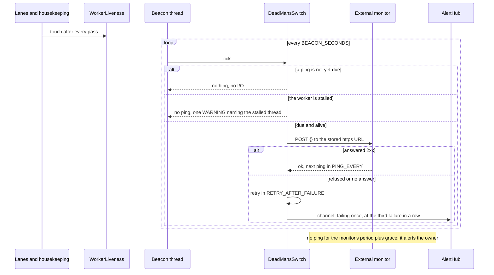
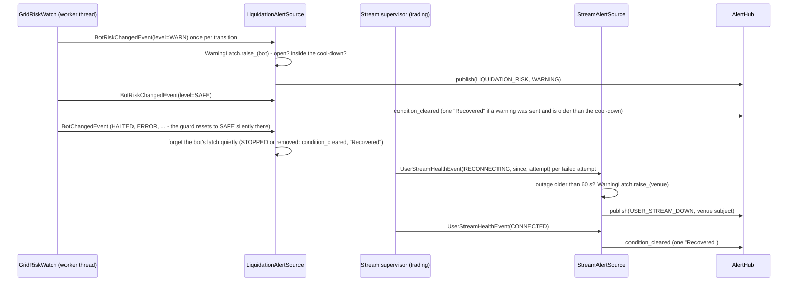

Status: Current

# `alerting` — 6. Runtime

*What happens, step by step, on the journeys that matter?*

## Built: one alert from `publish` to a channel

`publish` takes the hub's lock, runs the steps of [`05-building-blocks.md`](05-building-blocks.md)
and writes one alert row and one delivery row per admitted channel in one transaction
(`alert_hub.py` → `AlertHub._accept`; `sqlite_outbox.py` → `SqliteOutbox.enqueue`), then nudges the
lanes ( `alerting/adapters/wake_signal.py` → `WakeSignal.notify`). Each lane wakes, expires what is
too old, takes the due delivery of the highest severity and calls the channel outside every lock
(`channel_delivery.py` → `ChannelDelivery.run_due`, `ChannelDelivery._call`). A wait the platform
asks for pauses the whole channel, not one message, and survives a restart, because the next process
reads it back from the open `RETRYING` rows (`channel_delivery.py` → `ChannelDelivery._pause_until`;
`sqlite_outbox.py` → `SqliteOutbox.retry_horizon`). A CRITICAL left behind a wait longer than five
minutes is queued on another channel (`channel_delivery.py` →
`ChannelDelivery._fail_over_waiting_criticals`). Grouped alerts and the quiet-hours summary leave
from the housekeeping tick, `AlertHub.flush_due` (`alert_hub.py` → `AlertHub.flush_due`). A source
that sees its condition clear calls `condition_cleared`, which sends one INFO "Recovered" alert and
re-arms the key (`alert_hub.py` → `AlertHub.condition_cleared`).

## Built: boot

At boot the module starts the lanes, subscribes the bot sources to the bots' events, then seeds the
state source from the bots' report without alerting (`alerting/module.py` → `AlertingModule.boot`).
A read-only copy returns before any of it.

## Built: the skeleton journey — a bot halts on the VPS, Discord hears it once

The picture: [`diagrams/06-halt-to-discord.puml`](diagrams/06-halt-to-discord.puml). *Which thread
does what, and where is the alert safe if the process dies?* What the skeleton is, and what in it is
real: [`04-solution-strategy.md`](04-solution-strategy.md).

If the process dies after `enqueue`, the alert is sent at the next start; if it dies between
Discord's answer and `mark`, it is sent twice (at-least-once, the docstring of `alerting/contracts/i_outbox.py`).
A halt written by the bots' store and lost before `publish` is not covered: the source seeds its
last-seen states at boot without alerting, so the skeleton does not re-alert old halts on every
restart. `EPIC-036B` decides whether a boot-time "still halted" summary is wanted.

## Built: a filled order, a cycle and an exit reach Discord

`BOT-189`, `PRO-015` phase 1. On the bot's worker, `on_fill` returns the orders a fact filled whole
beside the new runtime (`bots/domain/grid/grid_reactions.py` → `on_fill`, `Reaction.filled`;
`grid_filled_order.py` → `FilledOrder`), with the cycle profit `book_cycle` booked and the run's totals
right after it. The executor saves the runtime, then publishes one `BotOrderFilledEvent` per filled
order (`bots/application/kinds/grid/grid_facts.py` → `GridFacts._apply_fill`;
`grid_fill_announcer.py` → `GridFillAnnouncer.announce`); a fill a reconcile applies from history after
a restart is announced only once the reconcile's runtime is kept: `GridMissedFills` hands the filled
orders over (`grid_missed_fills.py` → `GridMissedFills.take_filled`) and the callers that save the
outcome announce them (`grid_reconciler.py` → `GridReconciler.announce_kept_fills`); a reconcile that
ends in a mismatch or a wait announces nothing, because the next one applies the same fill again. The
alerting source words it and calls `publish` (`BotFillAlertSource.on_order_filled`); the hub treats it as
any INFO: deduplicated by the order, held in quiet hours, routed silent, bounded by `FillBacklog`.
A partial fill, a trade the run already counted and an exit's market sell announce nothing. A stop loss,
a take profit or a range exit that closes is `STOPPING` with its reason: `BotAlertSource` raises the
CRITICAL at once, with the bot's own detail ("price 2290, traded to 2288"). Nothing here places or
changes an order.

**The result of an exit (`BOT-190`).** The bot is STOPPED before the closing market slices fill, and the
slices are booked one by one afterwards, so the status report at STOPPED still holds the position at its
last price: neither the exit's fill price nor its fee. The message that tells the result therefore does
not come from the state change. The sequence is: the stop sends the exit slices and confirms STOPPED
(the stop loss message went out at the entry into STOPPING); each slice's fill is booked on the bot's
queue; the booking that leaves the run holding dust makes `GridExitReport` publish one
`BotExitClosedEvent` (`bots/application/kinds/grid/grid_exit_report.py` → `GridExitReport.after_exit_fill`); `BotExitAlertSource.on_exit_closed`
words the INFO `EXIT_CLOSED` ("Position closed") with the total of the run's books after that booking,
fee included. The proof is the composed test on the fake exchange
(`tests/integration/modules/bots/test_an_exit_tells_discord_its_result_once_the_last_slice_is_booked_on_the_fake_exchange.py`):
the message's total equals the books after the last fill and differs from the total at STOPPED. A stop
the owner asked for, a halt and the exchange-side stop send no such message.

**What a restart does.** The bot counts a fill once and so publishes it once; the dedup windows are in
memory ([`08-concepts.md`](08-concepts.md)), so the guarantee is the bot's, not the hub's. A fill that
happened while the app was closed is told once, by the reconcile that finds it.

**What is not measured.** Discord's real behaviour under a burst. What is measured, on the fake
channel (`tests/unit/modules/alerting/application/test_fill_backlog.py`): with a channel that answers 429,
60 fills and one CRITICAL, the lane tries nothing until the wait is over, then sends the CRITICAL first,
the newest 25 fills and one "35 fill messages skipped" line.

## Built: the Options page, Save and Send test

*(Since `EPIC-036D4` the page has a Telegram group beside Discord's: the same actions on the pool, the same fence, for the bot token and chat id; the sections below say "webhook" for what both channels do.)*

The picture: [`diagrams/06-options-save-and-test.puml`](diagrams/06-options-save-and-test.puml).
*Which thread does what, and where does the URL go?* Tools → Options → Alerts has one Discord
webhook field, masked, and the buttons Save, Remove and Send test. Each acts at once and runs off
the UI thread: the presenter begins an action (`alerts_settings_presenter.py` →
`AlertsSettingsPresenter._begin`), the pool thread runs the use case and reads the new state beside
it, so a locked keyring never blocks the UI thread (`AlertsSettingsPresenter._work_on_pool`), and
`AlertsActionRelay` delivers the answer on the UI thread, where the tracker checks the action is
still the current one (`AlertsSettingsPresenter._on_action_done`; a stale or post-`shutdown()`
answer is dropped, `AlertsSettingsPresenter.shutdown`). The buttons are off while one runs.

- **Save** puts the typed text in `DiscordWebhookSetup.save`: a value that is not a Discord webhook
  URL is refused with a sentence and nothing is written; a valid one goes to the keyring, the field
  is cleared and the page shows only the last four characters of the token
  (`discord_webhook_setup.py` → `DiscordWebhookSetup.save`). A host that provisions the webhook
  elsewhere answers first on read, so the page says "saved, but not used" and never "saved".
- **Send test** builds the catalog again and sends one loud TEST alert straight to the channel, as
  `alert test` does, so a webhook saved a moment ago is tested without a restart
  (`send_test_to_configured_channels.py` → `SendTestToConfiguredChannels.run`). The page shows the
  channel's own sanitised reason ("Discord refused the webhook message (404)").
- **Remove** asks first, with its own verbs (Remove webhook / Keep webhook) and the safe one as the
  default (`alerts_settings_view.py` → `confirm_removal`).

**Restart or hot rebuild: restart.** The lanes are started once at boot from the catalog's ids
(`threaded_delivery_host.py` → `ThreadedDeliveryHost.start`; `alerting_bindings.py` →
`bind_alerting`), and the hub, the status port and the delivery pass hold the run's catalog, which
is fixed for its life. A hot rebuild would need a mutable catalog, lanes started and stopped while
the hub routes, and a status that changes under the host's warning: machinery on the delivery path,
and a real-money-adjacent one, for a setting changed once. So a replaced webhook applies at the next
send (the channel reads its secret at each send, `discord_webhook_channel.py` →
`DiscordWebhookChannel.deliver`), but a first save or a removal changes the lane only after a
restart, and the page says so in its channel line (`alerts_words.py` → `channel_line`): "Saved, not
sending yet: restart the app to start sending", "Removed, but this run still has the Discord
channel: its alerts are refused until you restart the app". Whether the lane can start without a
restart is a task of its own if the owner wants it (`EPIC-036D`).

**No URL anywhere.** An unexpected exception raised under a save or a test can quote the webhook, so
the page shows and logs the exception's type name only (`alerts_settings_presenter.py` →
`AlertsSettingsPresenter._work_on_pool`, `AlertsSettingsPresenter._tell_failed`);
`test_alerts_page_never_shows_the_url.py` locks the logs, the notice and the labels on every path.

## Built: the dead man's switch, a ping while the worker is alive

*Which signal reaches the owner when the process dies, hangs or the machine powers off?* One that
stops: the app POSTs to an external monitor and the monitor alerts when the posts stop (`EPIC-036E1`,
[decision](../../../Tasks/epics/EPIC-036_alerting_module/DECISION_2026-10-20_dead_mans_switch.md)).



The first tick is at start. The URL is read from the secret store at each ping and is in no log, reason or
exception (`dead_mans_switch.py` → `DeadMansSwitch`, `DeadMansSwitch._ping`; the beacon logs an
escaped exception by its type name, `threaded_delivery_host.py` → `ThreadedDeliveryHost._run_beacon`).
The ping proves the process and its alert worker are alive, not that each bot is healthy: that is the
heartbeat's body (`EPIC-036E`, `heartbeat_service.py` → `HeartbeatService`; its per-bot health waits for `EPIC-035W`). A clean stop sends nothing, so the monitor fires after
its grace, which is wanted while resting orders stay on the exchange.

## Built: the heartbeat and the daily summary (`EPIC-036E`)
Once a second the housekeeping thread calls `HeartbeatService.tick` and then the hub's flush
(`alerting_bindings.py` → `_housekeeping_of`; `heartbeat_service.py` → `HeartbeatService.tick`).
The first tick of a process asks the outbox when a heartbeat was last sent
(`SqliteOutbox.latest_alert_at`); a summary is looked up by its key for the day
(`has_alert_keyed`), and a process started after the day's summary time marks that day done, so
a summary is missed rather than sent late. A heartbeat is
due when none was sent or `heartbeat_every` has passed; it asks the bots' status report through
`ICommandDispatcher` and publishes one INFO `HEARTBEAT` (`HeartbeatService._send_heartbeat`). A
report that cannot be read still produces a heartbeat that says so, with only the error's type. The
summary adds the last day's alerts counted by the outbox
(`SqliteOutbox.alert_counts_since`, `heartbeat_text.py` → `summary_text`) and is keyed by its date, so it never meets the quiet-hours
digest, which is keyed by its instant. Both go through `IAlertPublisher.publish`, so routing,
loudness (silent by default) and quiet hours treat them like any other INFO alert, except that the
summary is never held (`QuietHoursHold.holds`): held, it would arrive as a title in the digest.

## Built: an early warning — the position nears liquidation, the stream stays down

*What does the owner read before the bot halts?* Two facts that already happen and were only logged
(`EPIC-036B1`, [decision](../../../Tasks/epics/EPIC-036_alerting_module/DECISION_2026-10-20_early_warnings.md)).



A bot that leaves the states the guard judges (`bots/domain/bot_lifecycle_fsm_matrix.py` →
`PRICE_STALENESS_HALTS`) is reset to `SAFE` by the guard without an event, so the source forgets its
latch on any other state; otherwise a halt and a resume would leave the warning "open" and hold back
every later one. A `SAFE` inside the cool-down leaves the warning open (no "Recovered" that a
re-cross would make false), and a `WARN` on a warning still open after the cool-down is told again.

The liquidation warning is raised on the **warning** distance and ended on the return to `SAFE`,
which the classifier reaches only above `liq_warn_distance x liq_rearm_factor`
(`bots/domain/grid/futures_risk_classifier.py` → `classify_risk`), so a mark price hovering on the
line is one warning. The critical distance halts the bot and arrives as `BOT_HALTED`. The stream
supervisor publishes one event per failed attempt, at most about a minute apart
(`trading/adapters/binance/user_stream_supervisor.py` → `ReconnectPolicy`), so the outage is told at
the first attempt after the grace without a timer; the bots halt at `UserStreamLimits.down_limit`
(`bots/application/services/watches/user_stream_watch.py` → `UserStreamLimits`), after the notice. A
stream that is silent while still reporting `CONNECTED` is not seen here: it is the periodic
reconcile's to catch (`UserStreamLimits.reconcile_every`), and an alert for it is the follow-up in
`EPIC-036B`. No text of the connection's failure and no key is copied into either alert.

## Built: a reason that is its own condition — a rejected key, a rate limit, a storage pause, a quiet feed

*What does the owner read when the cause matters more than the state?* A bot is `HALTED` for forty
reasons; four are conditions of their own (`EPIC-036B2`,
[decision](../../../Tasks/epics/EPIC-036_alerting_module/DECISION_2026-10-20_reason_alerts.md)).

```mermaid
sequenceDiagram
    participant B as Bot (worker thread)
    participant S as BotAlertSource
    participant R as REASON_ROUTES
    participant H as AlertHub
    B->>S: BotChangedEvent (HALTED / ERROR / PAUSED, reason)
    S->>R: own_route_on_entry(state, reason)
    alt key_rejected, storage_failure
        S->>H: publish(KEY_REJECTED | STORAGE_FAILURE) with a fixed sentence
    else any other reason
        S->>H: publish(BOT_HALTED | BOT_ERROR) with the bot's Reason line
    end
    B->>S: BotRecoveryStalledEvent(reason, waited_s)
    S->>R: stalled_route(reason)
    alt price_feed_stale or rate_limited
        S->>H: publish(PRICE_FEED_STALE | RATE_LIMITED), grouped per venue; the feed one is hidden by USER_STREAM_DOWN
    else
        S->>H: publish(BOT_RECOVERY_STALLED)
    end
    B->>S: BotChangedEvent (RUNNING)
    S->>H: condition_cleared for each kind above (one "Recovered" if it was sent)
```

The entry into `AWAITING_RECOVERY` stays silent (`EPIC-042` D11); the grace of a quiet price feed is
the recovery rule's own `stalled_after`, so no timer is added here
(`bots/domain/halt_recovery_policy.py` → `DEFAULT_RULE`). The halt that says the automatic recoveries are
used up is still the `BOT_HALTED` with its `Reason:` line. A rate limit is a wait since `EPIC-042F` (`AWAITING_RECOVERY`, silent on entry): when it stalls
it is a WARNING `RATE_LIMITED` whose sentence says the ladder still rests and the bot resumes by itself;
a rate limit that is a plain `HALTED` (a pause too long to wait, or a used-up budget) is the generic
CRITICAL halt, whose `Reason:` line says to resume by hand. A rejected key and a storage pause are
CRITICAL because orders may rest that this app cannot manage. A stop does not end these conditions,
only a return to `RUNNING`, so no "Recovered" is sent while the cause stands.

## Built: the Alerts screen reads the history (`EPIC-036D2`)

*Which thread reads the outbox, and how often?* The Alerts mode is built at start with every
mode (SPEC-011 §4). Its presenter reads nothing when it is built (a read then started pool threads
the window's shutdown does not own); it reads the whole list when its mode is shown
(`AlertsPresenter.on_mode_shown`) and when Refresh is pressed, and a `QTimer` on the UI thread
reads in the background first after `FIRST_READ_MS` (5 s) and then every `REFRESH_INTERVAL_MS`
(15 s), whether or not the mode is visible, because the status-bar indicator is there in every
mode (`EPIC-036D3`); a hidden mode reads only `HEALTH_LIMIT` (1) alert, because a channel's health is its own newest
delivery (`IOutbox.latest_real_delivery`, not bounded by a window) and that read updates the
indicator only, never the list. A failed read turns the indicator to `Alerts: unknown` and is
logged once per run of failures; a Refresh asked while a hidden read is out starts the full read
when that one ends. Clicking the indicator asks the window's `INavigationService`, resolved at the click (it
exists only once the window is built), to show the mode. The read runs on the pool
(`alerts_presenter.py` → `AlertsPresenter.refresh`, `AlertsPresenter._read_history_on_pool`) because
`IOutbox.history` queries the database. One read is out at a time: a timer tick or a click while
one runs is ignored. The answer is handed to the UI thread by `AlertsActionRelay` and applied only
if the tracker says it is still the current one (`AlertsPresenter._on_read_done`); after
`AlertsPresenter.shutdown` none is delivered. A failed read keeps the last list and shows the
exception's type name only. The read takes the outbox's short lock like any other caller and holds
none across the view.

## Planned

Telegram and the remote command are drawn in design 036 §9 and §11 and are drawn here when
`EPIC-036C` and `036F` build them.
