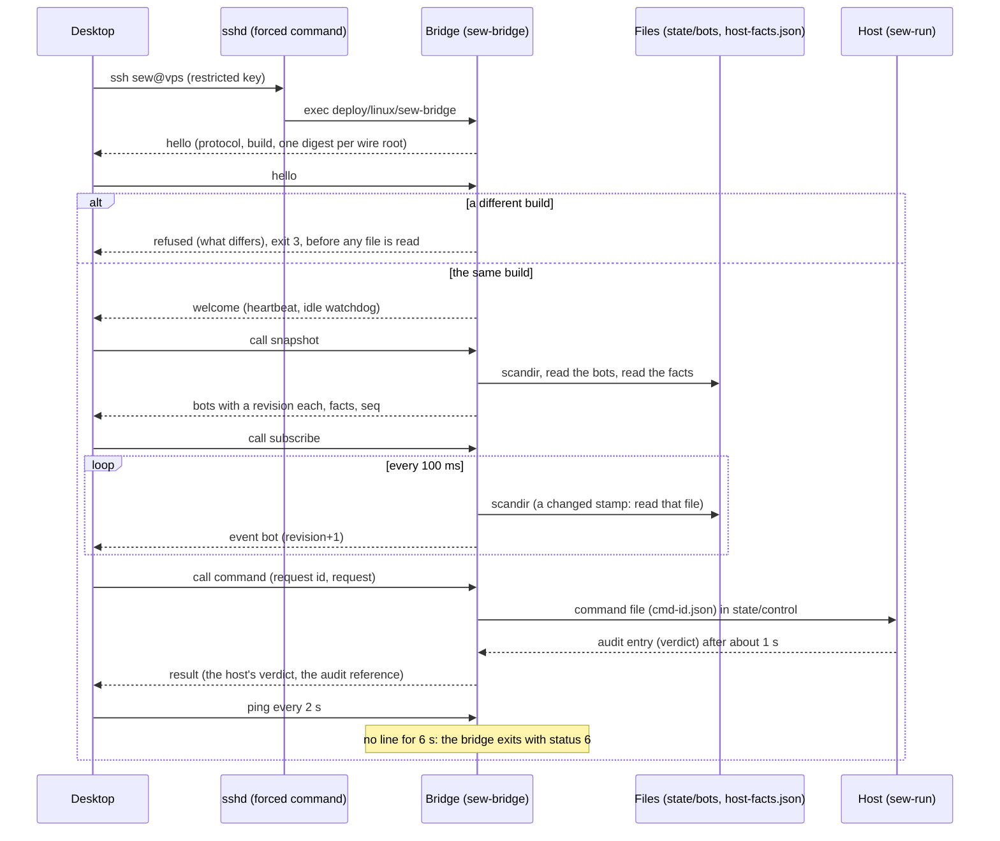

Status: Current

# `bots` — 7. Deployment

*Which thread runs what, what is shared, which files it writes, what a second process does, and how
the host runs it?*

[`diagrams/07-threads.puml`](diagrams/07-threads.puml) — *which thread runs what for the bots, and
which one writes a running bot's file?*

## Built: threads

Each bot has its own worker thread and FIFO queue, so one slow bot never delays another
(`bots/adapters/thread_bot_work_queue.py` → `ThreadBotWorkQueue`, one queue per bot from the factory's
`queues` argument, `bots/composition/executor_bindings.py` → `grid_executor_deps`). Everything that
changes a running bot runs there: the router on the bus thread only copies an event and queues it
([`05-building-blocks.md`](05-building-blocks.md)). Periodic checks run on `ThreadBotTicker`
(`bots/adapters/thread_bot_ticker.py` → `ThreadBotTicker`): one ticker, named `bots-ticker`
(`.../executor_bindings.py` → `_build_ticker`), with a daemon thread per task. A bot waiting to recover has its recovery run posted onto its own worker at that beat (`.../kinds/grid/recovery/grid_halt_recovery.py` → `GridHaltRecovery.check`), so the attempt, the cancels and the new ladder run on the thread that owns the bot and never beside a fill. The account-level loss cap's sample (`EPIC-026L`; `bots/application/services/loss_cap/account_loss_cap.py` →
`AccountLossCap.sample`) is one more task on that ticker, so it has a daemon thread of its own;
its acknowledgement arrives on the host's command thread, and one lock guards its record while the
reads, the stops and the publish run outside it. The user-stream and
sleep watches re-arm on the retry scheduler's heartbeat ([`10-quality.md`](10-quality.md) gives the
periods). `BotsModule.shutdown` (`bots/module.py` → `BotsModule.shutdown`) closes the scheduler first,
then the price streams, then every worker, each after running what is queued, so the app exits with
no bot thread left and nothing half-written.

## Built: files, and who writes them

Each bot is one file, `state/bots/<id>.json`, under the data root
(`bots/composition/state_bindings.py` → `bots_directory`), written atomically by `JsonBotStore`; its
shape is in [`08-concepts.md`](08-concepts.md). Four writers call `IBotStore.save`, each in its own phase
of the bot's life:

| Writer | Thread | When it may write |
| :--- | :--- | :--- |
| `BotRunState` (`.../bot_run_state.py` → `BotRunState`) | the bot's worker | while the bot has a worker: every fill, transition and update of a run |
| The create, edit and venue-change use cases (`.../create_bot/handler.py` → `CreateBotCommandHandler`; `.../edit_bot/handler.py` → `EditBotCommandHandler`; `.../change_bot_venue/handler.py` → `ChangeBotVenueCommandHandler`) | the caller's | a bot at rest only: the lifecycle admits `edit` in `DRAFT` and `STOPPED`, and a venue change in a Spot `DRAFT` that never ran (`bots/domain/bot.py` → `Bot.edited`, `Bot.moved_to`) |
| `BotRunner.start` (`.../bot_runner.py` → `BotRunner.start`) | the caller's | once, the `STARTING` it saves after retiring the earlier run's worker and before it queues the new one ([`06-runtime.md`](06-runtime.md)) |
| `BotRestoreService.restore_all` (`.../bot_restore_service.py` → `BotRestoreService.restore_all`) | boot | before any worker exists or any event is subscribed |

**Rolling back across `AWAITING_RANGE`** (`EPIC-044B`). An older build refuses a file whose state is `AWAITING_RANGE`, or whose reason is `entry_refused`, as unreadable (`decode` rejects an unknown state or reason value), reports it and leaves it untouched. Before a downgrade, stop every bot the status report lists as waiting for its range. A waiting bot holds no order and no position, so stopping it loses nothing.

On a headless host a waiting bot comes back as `RECOVERING` after a restart, like a running one: `run --resume-recovering` (with the mainnet venue confirmation, which `restarts_into_recovering` already covers) returns it to waiting; `--start-planned` alone does not.

**Rolling back across `AWAITING_RECOVERY`** (`EPIC-042B`). An older build reads the new `recovery_attempts` key as nothing (it reads only the keys it knows) and so loses the ledger on its next write. It **refuses** a file whose state is `AWAITING_RECOVERY` (`bots/adapters/persistence/bot_record_codec.py` → `decode` rejects an unknown state value): the bot is *reported* as unreadable, left untouched and never dropped (`bots/contracts/i_bot_store.py` → `RefusedBotFile`), and the host's pre-flight fails on it. So before a downgrade, resume or stop every bot in `AWAITING_RECOVERY`; the status report lists them (`bot list`, the `awaiting_recovery` count in the health snapshot).

**The loss cap's record.** One more file, `state/loss_cap.json`, beside the bots' folder and not in it
(a file inside would be read as a bot; `bots/composition/loss_cap_bindings.py` → `loss_cap_record_path`), written
atomically by `bots/adapters/file_loss_cap_store.py` → `FileLossCapStore`. Its only writer is
`AccountLossCap`, on the sampling thread (the day's ledger, when it changes, and a trip) and on the
host's command thread (an acknowledgement). A host with no figure set never writes it.

## Built: a second process

A second process on the same data root is read-only (`EPIC-035H`): `boot()` returns before restoring
any bot or subscribing to fills (`bots/module.py` → `BotsModule.boot`; the writable half is
`bots/composition/writable_boot.py` → `boot_writable`, reached by path so a read-only copy does not
import it, `PRO-014`), because a restart rule run
there would rewrite the first copy's running bots, and the store and the runner are the read-only
wrappers. `bot list`, `bot show` and `status` read through the same queries the Bots tab reads through.
A read-only Bots tab hears no `BotChangedEvent` (the writer publishes on its own process's bus), so it
re-reads the bots' files on its 30 s clock (`bots/ui/bots_screen/presenter_pacing.py` → `BotsClock`;
`BUG-227`); the writing copy does not.
`bot show` also prints the bot's effective halt-recovery table, one `Recovery` row per reason with the
attempts used inside its window, or `no automatic recovery (<layer> layer)` for a Futures bot
(`bots/application/queries/get_bot_status_report/recovery_table.py` → `recovery_table_of`; `EPIC-042G`).
`bot list` prints the run's grid profit, completed cycles, realised and total PnL (`BOT-192`; grid profit net of both legs' fees and without Futures funding; `BOT-231` added Realised, which contains the grid profit) with three legend lines (`TOTAL_PNL_LEGEND`, `REALISED_LEGEND`, `GRID_PROFIT_LEGEND`); `bot show` prints every earnings figure in the order that adds up (`BOT-229`): realised, grid profit and cycles, held, unrealised, fees paid, funding, then the total with its sum and the basis (`bots/cli/bot_earnings_rows.py` → `earnings_rows`). They are the Bots tab's figures and words, its table's `Grid profit`, `Cycles` and `Realised` columns and its Results rows, built once in `bots/contracts/run_earnings.py` → `RunEarnings`, `realised_text`, `held_text`, `grid_profit_text`, `total_pnl_text`, `EARNINGS_BASIS`, `GRID_PROFIT_LEGEND`, the summary column's words (`REALISED_HEAD`, `REALISED_COLUMN_TITLE`, `REALISED_LEGEND`), and the row titles (`REALISED_TITLE`, `GRID_CYCLES_TITLE`, `UNREALISED_TITLE`, `FEES_TITLE`, `FUNDING_TITLE`, `TOTAL_SUM_TITLE`),
`plain_money`, `plain_price` (Qt-free, because a headless host installs no Qt) from `BotProgress`; `GetBotStatusReportQueryHandler` fills
`BotStatusEntry.earnings`, `bots/cli/bot_status_reports.py` prints it. Read from the bot's file, no exchange call.
The total is worded once as *net of fees and funding, at the bot's last trade price* (`run_earnings.py` → `TOTAL_PNL_BASIS`, `TOTAL_PNL_TITLE`, `TOTAL_PNL_HEAD`, `TOTAL_PNL_LEGEND`): the Bots tab column, the `bot list` head with a legend line under the table, and the `bot show` basis line under the total. A Futures exchange's own position PNL is gross of fees, excludes funding and uses the mark price, which the bot does not save, so `bot show` prints `Unrealised, exchange basis` as not available (`exchange_unrealised_text`) instead of a figure at a price nobody heard (`BOT-202`). `bot show --json` carries `realised`, `held`, `average_cost` (`BOT-229`), `commissions`, `funding`, `cost` and `mark_price_at` beside the total (`bot_status_report.py` → `_earnings_payload`). Each printed figure is rounded on its own, so the parts of the printed sum can differ from the printed total by a cent or two.
`bot show` also prints the Grid bot's ladder summary, the average cycle it booked and where the last price it heard stands, `bot show --grids` one row per grid and `bot list` a `GRID STEP` column (`BOT-193`): the Bots tab's Plan rows and Ladder table, built once in `bots/contracts/grid_ladder.py` → `grid_ladder_of` and worded by `bots/contracts/grid_ladder_texts.py` (Qt-free), carried by `BotStatusEntry.ladder` (`GetBotStatusReportQueryHandler` fills it with the bot clock's `now`), printed by `bots/cli/bot_status_reports.py` → `bot_show_grids_report`, and in JSON by `bots/contracts/grid_ladder_payload.py` → `ladder_payload`. Read from the bot's file, no exchange call; the maker fee rate is recorded when a run starts (`BOT-194`), so the net columns are filled for a run that recorded one and blank for an older file; the Futures liquidation price is not in the file, so its row says so.
`bot order <id>` (`BOT-187`) prints the orders the bot's file records, the Bots tab's orders table
(`BotProgress.orders` through `GetBotQuery`). The verb is `bots/cli/bot_order_verbs.py` → `OrderBotVerb`;
the report is built in `bots/cli/bot_order_reports.py` → `bot_order_report`. It is stored, not live, and asks the exchange
nothing: live open orders need an order session and are a later source behind the same report.
Design: design 038 §5.2 (`status` from a second process).

## Built: the facts only the running host holds (EPIC-047B)

A second process reads the store's files and sends commands through the host's command directory, but
it can reach nothing the running host keeps in memory, and the host listens on no socket
([`../../../Tasks/epics/EPIC-047_vps_bots_tab/DECISION_2026-10-24_the_remote_link_is_a_bridge_behind_a_forced_command.md`](../../../Tasks/epics/EPIC-047_vps_bots_tab/DECISION_2026-10-24_the_remote_link_is_a_bridge_behind_a_forced_command.md),
D4). So the host writes those facts to **`state/host-facts.json`**, owner-only (`0600`) and atomically, the
way it writes `state/health.json`, and the bridge (`EPIC-047C`) reads it; the bridge never calls the
exchange and never holds a key.

| Group | Where it is read | What it is |
| :--- | :--- | :--- |
| Enabled venues | `src/modules/trading/contracts/i_venue_trading_ports.py` → `IVenueTradingPorts.enabled` | the venues in configuration order |
| Key state | `src/modules/trading/contracts/i_venue_key_states.py` → `IVenueKeyStates.key_saved` (`EPIC-047C`), over `src/modules/trading/composition/venue_assembly.py` → `stored_credentials_provider` | *a key is saved or not*, for **every enabled venue**, built or not, never the key |
| Leases | the venue's `ITradingSession.lease_holder` (`src/modules/trading/contracts/i_trading_session.py`), read only on a venue `IVenueContexts.built` lists | the holder (a bot's or the Trade tab's owner id, or `""`) of each symbol a stored bot is on, per enabled venue; `""` on a venue nothing has built, whose session (and so whose lease) does not exist yet |
| Budget caps | the `OwnerBudgetCaps` trading binds | the owner's three caps |
| Exchange facts | `bots/adapters/recorded_venue_facts.py` → `RecordedVenueFacts`, remembered by `bots/adapters/latest_venue_reads.py` → `LatestVenueReads` | the latest `VenueSnapshot` each bot's own readiness read took, with its `read_at` |

`bots/adapters/trading_host_held_facts.py` → `TradingHostHeldFacts` builds the value
(`bots/contracts/host_held_facts.py` → `HostHeldFacts`, through `bots/contracts/i_host_held_facts.py` →
`IHostHeldFacts`), bound by `bots/composition/host_facts_bindings.py` → `bind_host_facts`. It is read-only
and local: it asks no exchange, and it reads a venue's session only when `IVenueContexts.built` lists the venue, because
`IVenueContexts.get` builds a venue's adapters; the key state comes from `IVenueKeyStates`, which builds nothing but the stored key's provider. **Two things follow, and a reader must know them:**

- **An exchange fact is as old as the last read that took it, and the host reads again on a schedule (`EPIC-047H`).**
  `RecordedVenueFacts` decorates `IVenueFacts` (`bots/composition/executor_bindings.py` → `_build_venue_facts`) and
  asks its inner reader exactly as often as before, so a Start, a Resume or a screen load take a snapshot and
  `read_at` says how old. Since the VPS tab reads nothing at Binance, the host also reads a bot's facts again every
  `operations.vps_facts_refresh_interval_s` (120 s) under a weight ceiling, and records only a read that happened
  (see the next section; this replaces `DECISION_2026-10-26_the_bridge_revision_and_the_unbuilt_venue.md` D3, as
  `DECISION_2026-10-27_a_vps_bot_reaches_binance_only_through_the_vps.md` D4 says).
- **A venue nothing has used shows its key state and a lease with no holder** (`EPIC-047C`: the owner's
  default decision, `DECISION_2026-10-26_the_bridge_revision_and_the_unbuilt_venue.md`). `IVenueKeyStates` builds a provider
  for each question and keeps none, because the mainnet provider keeps its first read for the life of the process and a kept
  one would hide a key the enrolment script saved later; the cost is one read of the secret stores per enabled venue per
  look (every `FACTS_POLL_SECONDS`).

Everything else is `operations`' (it has no design folder yet; the file is the module's, `src/modules/operations/module.py`
→ `OperationsModule.boot`):

| Question | Answer |
| :--- | :--- |
| Who writes, and on which thread? | one daemon thread named `host-facts-writer` (`operations/application/host_facts_publishing.py` → `HostFactsPublishing`); the scheduler's job only raises a flag, so a full disk or a key store that hangs delays the file and nothing else; a stuck write is never joined by a second one |
| When? | the facts are looked at every `FACTS_POLL_SECONDS` (2 s); the file is written when they differ from the last written ones (value equality, `operations/application/document_publisher.py` → `DocumentPublisher.tick`) and at least every `FACTS_HEARTBEAT_SECONDS` (15 s), both in `operations/contracts/host_facts_document.py` |
| What does a reader check? | `schema` (`sew.host-facts/1`), `revision` (grows by one a write and continues across restarts: `first_revision_after`), `written_at` and `heartbeat_s`; `operations/application/host_facts_watch.py` → `HostFactsWatch` keeps the last good header across a torn, missing or older file and calls a host dead after `LIVE_AFTER_HEARTBEATS` (3) heartbeats |
| What is never in it? | a key, a secret, an exception's text: the fields are written by name, and the two free-text fields an exchange failure fills (`bots/contracts/host_held_facts.py` → `UNPUBLISHED_TEXT_FIELDS`) are replaced by `operations/adapters/json_host_facts_codec.py` → `UNAVAILABLE_WORDS`; the reason stays in the host's log |
| How is it written? | `operations/adapters/owner_only_atomic_file.py` → `write_owner_only_atomically`: a temporary file created `0600`, fsync, `os.replace` (Windows: the file inherits `state/`'s ACL) |
| What if it fails? | logged at ERROR once per cause (`FailureCause`), at INFO once on recovery; never raised; the file then goes stale, which a reader sees |
| What does a stop do? | the job is cancelled and the file is left: its age grows, which is how a reader tells a stopped host |
| Which seam keeps the encoding replaceable? | `operations/contracts/i_host_facts_codec.py` → `IHostFactsCodec`: `EPIC-047A`'s codec replaces `JsonHostFactsCodec` without changing what the file holds; `decode` reads the whole file back (`EPIC-047C`), tolerantly: an unknown key is ignored, a missing one takes the field's default, a wrong one is `HostFactsUnreadableError` (`operations/adapters/host_facts_body_decoder.py` → `read_held_facts`) |

**Known limit.** A lease is read for each symbol a stored bot is on; a lease on a symbol no bot is on (a Trade
tab strategy's) is not in the file, because `ITradingSession` has no way to list its leases.

## Built: what the host serves the VPS tab besides the facts (EPIC-047H)

The VPS tab opens no connection to Binance ([`../../../Tasks/epics/EPIC-047_vps_bots_tab/DECISION_2026-10-27_a_vps_bot_reaches_binance_only_through_the_vps.md`](../../../Tasks/epics/EPIC-047_vps_bots_tab/DECISION_2026-10-27_a_vps_bot_reaches_binance_only_through_the_vps.md),
D1). The host is the only client of the exchange, and it writes three more things for the bridge to tail; the bridge
still calls no exchange and loads no key (D2). Everything here only **reads**: it places, cancels and starts nothing,
and it opens no connection of its own (`tests/unit/architecture/test_the_vps_feed_reads_only_and_opens_no_connection.py`).

| What | File or source | Who writes it | When |
| :--- | :--- | :--- | :--- |
| Last price, mark price, the forming candle of each timeframe | `state/market-data.json` (`operations/contracts/market_data_document.py` → `MarketDataDocument`) | worker `market-data-writer` (`operations/application/document_publisher.py` → `DocumentPublisher`, run by `HostFactsPublishing`) from `operations/application/market_recorder.py` → `MarketRecorder` | looked at every `MARKET_POLL_SECONDS` (1 s), written on a change, heartbeat `MARKET_HEARTBEAT_SECONDS` (5 s) |
| Planner inputs, fills, symbol rules of each bot | `state/host-reads.json` (`operations/contracts/host_reads_document.py` → `HostReadsDocument`) | worker `host-reads-writer`, from `bots/adapters/latest_exchange_reads.py` → `LatestExchangeReads` | looked at every `HOST_READS_POLL_SECONDS` (5 s), heartbeat 30 s |
| Exchange facts of each bot | `state/host-facts.json` (as above) | `HostFactsPublishing`, from `LatestVenueReads` | a refresh's read shows within `FACTS_POLL_SECONDS` |
| Closed candles | the host's candle store, opened read-only by the bridge (`market_data/adapters/persistence/readonly_candle_shards.py` → `ReadOnlyCandleShards`) | the host's `market_data` writer | on the bridge's `candles` call |

**The recorder reuses what the host holds.** `MarketRecorder.on_tick` listens to the `MarketTickEvent`s the bots' price
streams already publish (`bots/application/services/watches/bot_price_watch.py` → `BotPriceWatch` holds one **1m**
kline stream per bot not at rest), and `MarketRecorder.snapshot` asks the mark board (`trading/contracts/i_mark_board.py`
→ `IMarkBoard`) for the mark the exit watch reads each beat (`trading/application/orders/order_entry_terms_service.py` →
`OrderEntryTermsService.mark_price_for` records it). It stores and returns; it never delays a tick. The forming candle of a
longer timeframe is folded from the 1m ticks (`operations/application/candle_fold.py` → `CandleFold`) and is flagged
`complete` only when the host saw the bucket from its first minute. The timeframes are the Bots chart's own default list
(`core/vo/market_timeframes.py` → `DEFAULT_CHART_TIMEFRAMES`). A symbol with no stream (the bot is at rest) has no live
price: its entry ages in the file and drops after 24 h.

**The refresh and its ceiling.** `operations/application/vps_facts_refresher.py` → `FactsRefresher` runs on one worker
(`operations/application/facts_refreshing.py` → `FactsRefreshing`, thread `vps-refresh`) and reads, through
`bots/application/services/host_reads/exchange_bot_read_refresh.py` → `ExchangeBotReadRefresh`, the same queries and
readers the Bots tab uses. A bot's round is its facts read, and on every tenth round its planner inputs and its fills,
each a read of its own; an asked-for refresh is a round with all three; the static exchange info of a venue is read at
start and every 24 h. Three things hold the weight:

| Bound | How it is held | Where |
| :--- | :--- | :--- |
| Priority | every read goes out at `RequestPriority.ROUTINE`, so it waits at the 70 % line and never touches the exit reserve; the adapter opens no scope of its own and refuses to read inside someone else's | `ExchangeBotReadRefresh.refresh`; `trading/adapters/binance/exchange_call_policy.py` → `ExchangeCallPolicy` |
| Ceiling | a share of the venue's minute weight (`operations.vps_facts_weight_ceiling_pct`, default 3, highest 10, enforced in `operations/contracts/vps_feed_settings.py` → `VpsFeedSettings.judged`); a read goes only when the ledger has room for its expected cost, and its cost is the rise of the used-weight header around it (`trading/contracts/i_venue_weight_meter.py` → `IVenueWeightMeter`, read from the call policy) | `operations/application/vps_refresh_budget.py` → `VenueBudget`; `operations/application/vps_weight_ledger.py` → `WeightLedger`; `operations/application/vps_refresh_costs.py` → `measured_weight` |
| No burst | after a read the venue waits the share of the minute that read is of the ceiling (`VenueBudget.pace`), so reads are evenly spread; a closed gate or a full ledger holds the venue and the oldest overdue bot is read first | `VenueBudget.hold`, `FactsRefresher._hold` |

The interval therefore stretches with the bots. Simulated for three hours on a fake clock with the planning weights
(`tests/unit/modules/operations/vps_feed/`): the median gap between two facts reads of one bot is 120 s with one bot and with
five, and about 410 s with twenty; the most weight spent in any minute was 55, 70 and 70 of the 72 allowed. The planner
and fills reads (about 55 weight a bot, every tenth round) give way to other bots' facts reads when the ceiling has no room, so
under load they come later, not earlier. A failed read keeps the last snapshot and its `read_at` and is logged once per
cause (`[vps-refresh]`). The on-demand verb is `bot refresh-facts <id>` (`core/contracts/host_control.py` →
`HostControlAction.REFRESH_FACTS`): the host queues it and answers at once (`operations/application/refresh_facts_outcome.py`
→ `refresh_outcome`), at most once per 30 s per bot, counted inside the ceiling.

**What it cannot do.** The `market_data` REST client does not pass `ExchangeCallPolicy`, so a candle backfill would not be
seen by the gate or the header: it is charged to the ceiling by estimate (10 weight a call), see below. The host streams the
1m kline only, so the forming candles of longer timeframes are partial after a start.

## Built: the bridge on the host (EPIC-047C)

The desktop reaches the host through a **second process** that `sshd` starts for each session behind a
forced-command key for the `sew` account ([`../../../Tasks/epics/EPIC-047_vps_bots_tab/DECISION_2026-10-24_the_remote_link_is_a_bridge_behind_a_forced_command.md`](../../../Tasks/epics/EPIC-047_vps_bots_tab/DECISION_2026-10-24_the_remote_link_is_a_bridge_behind_a_forced_command.md),
D2 and D3). It listens on nothing, loads no key and calls no exchange; it reads the store's files and the host-facts
file and writes a command into the host's control directory.

| Question | Answer |
| :--- | :--- |
| Where is it? | the loop is `support/wire/bridge/bridge_session.py` → `BridgeSession` (no I/O of its own) with `bridge_runner.py` → `serve` (the pipes and threads); the ports are `support/wire/contracts/` (`IBridgeBots`, `IBridgeFacts`, `ICommandDoor`, `IBridgeCandles`); `bots/link.py` → `bridge_bots`; `operations/link.py` → `bridge_facts`, `bridge_door`, `bridge_documents`; `market_data/link.py` → `bridge_candles` implement them; `shell/link_bridge_main.py` → `main` composes them |
| Why a `link.py` beside `module.py`? | `module.py` loads every handler and adapter of the module (about a second on the VPS) and the bridge starts for each session; `link.py` imports the wire roots and the reader only. `tests/unit/architecture/boundaries/zones.py` → `is_module_entry_point` lets `shell/` import both, and nothing else of a module |
| How does it start? | `deploy/linux/sew-bridge` is the key's `command=`; it ignores what the client asked for and execs `python -m Sagittarius_Elite_Warrior.src.shell.link_bridge_main` with `SEW_DATA_ROOT`. The `authorized_keys` line is an operator step (`EPIC-047G`) |
| Which threads? | the main thread (feeds the session, ticks it every 50 ms), a reader thread on standard input, and one short-lived thread per waiting command, at most four (`bridge_protocol.py` → `MAX_PENDING_COMMANDS`); every message is one line written under one lock |
| What is a revision? | the bridge's own counter per bot, +1 each time a bot file's stamp (modification time, size, inode) changes; a session-long number, so the desktop makes a new `RevisionGate` for each connection and takes a snapshot first. A counter in the bot record was rejected, see the decision record |
| How is a command sent twice, once? | the desktop's 32-hex request id becomes the command id (`operations/adapters/replaying_command_door.py` → `ReplayingCommandDoor`); `operations/adapters/directory_host_control.py` → `DirectoryHostControl.send` answers an id the host's audit already settled (a different action under the same id is refused in words), and waits for a file still left for the host instead of writing it again; a send that wrote nothing never withdraws another send's file and says only what it saw; the bridge refuses a second call while one with the same request id waits (`bridge_commands.py` → `BridgeCommands.start`) |
| How long may a desktop be silent? | `bridge_protocol.py` → `IDLE_WATCHDOG_S` (6 s), a third of which is `HEARTBEAT_S`; any line resets it. The process exits with status 6, whatever `sshd` believes |
| Exit statuses | 0 the session ended, 3 refused (a different build), 4 a protocol violation, 5 a failure nobody planned for (a port raised; logged with its traceback, the desktop gets a word and never the exception's text), 6 the idle watchdog (`bridge_protocol.py`) |
| What can it not do? | open a socket (the process holds none, `tests/integration/modules/operations/test_the_bridge_process.py`), load a key, call an exchange, write a bot (the store it holds is `ReadOnlyBotStore`), or reach any command but the host's own door |
| What does it read? | `<data root>/state/bots/` (the default place; `bots.state_dir` is not honoured, a key that exists for a test boot), `<data root>/state/host-facts.json`, `market-data.json` and `host-reads.json` (looked at every `DOCUMENTS_LOOK_S`, 0.5 s, as events of kind `facts`, `market`, `reads`), and, on a `candles` call, the candle store `<data root>/database` read-only; it writes only `<data root>/state/control/` through the door |

**Known limits.** The readiness reads are not in the bridge: the bridge hands over the bots and the facts file, from
which the desktop assembles the Run step's facts (`GetBotRunFactsQuery` is a pure function of the file and the bots); a bot's
fills, the planner inputs, the market data and the closed candles are in the files and the `candles` call above (`EPIC-047H`).
A command adds up to about a second (the host polls its control directory every second).

## Built: the headless host

On the headless host `operations`' `run` boots the same module with no window. What stopping does to
the bots is a shutdown policy chosen on the command line (design 038 §6.1, decision O1): leave the
orders resting, the default and what the shipped unit runs (`--on-stop leave-orders`,
`deploy/linux/sew-run.service`; `src/modules/operations/adapters/leave_orders_resting.py` →
`LeaveOrdersResting`; a Futures bot is left only while a stop on the exchange covers its position and is closed otherwise,
`EPIC-038M`, [`06-runtime.md`](06-runtime.md)), or stop every bot first (`src/modules/operations/adapters/stop_bots_first.py` →
`StopBotsFirst`). A restart leaves running bots `RECOVERING` until a person resumes them, or until
`run --resume-recovering` does (design 038 §6.2, decision O2;
[`06-runtime.md`](06-runtime.md)). A `HALTED` or `AWAITING_RECOVERY` bot is resumed by a person, or by
`run --resume-halted` (`EPIC-042E`, ADR 042 D13), which gives the screen's Resume and Confirm in advance. Between a stop and the next start nothing watches a stop loss or a
take profit; `EPIC-039L` closes that gap on Futures with an order resting on the exchange, and the host leaves a Futures bot only under it.
