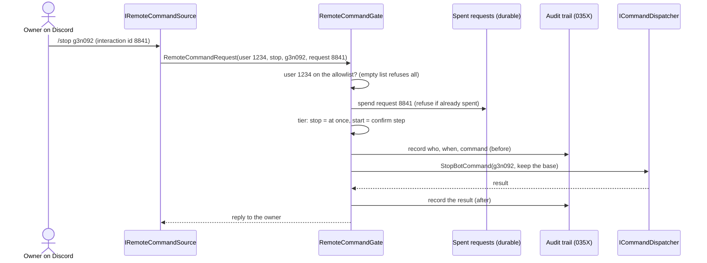

# ADR — Remote control is a gated, allowlisted, outbound-only door whose first release is status, pause and stop

**Epic:** [EPIC-036](README.md)
**Date:** 2026-10-21
**Status:** Proposed
**Decided by:** Pending — the owner. The coordinator asked for a design record only, then to stop (relayed 2026-10-20/21). D1 and D2 restate what the owner approved on 2026-10-08 (N6); D3 to D7 are proposals.
**Task:** [EPIC-036F](incomplete/EPIC-036F_remote_control_from_discord.md) (blocked; this record is its design step)

| Label | Meaning |
| :--- | :--- |
| ✅ Established | confirmed on the code tree at the commit §1 names |
| 🔵 Proposed | an option awaiting a decision; not accepted |
| 🟢 User decision | decided by the user (the owner's approval of the design, 2026-10-08) |
| ❓ Open | blocks the named phase until answered |

## 1. Context
An alert that says "bot g3n092 halted" is most useful when the owner can answer from the phone. The risk is the one every trading-bot owner meets: the door that lets you stop a bot lets anyone with the same access do it, a command can arrive twice, and a mainnet Start must never be one tap.

What is true of the tree at `137fe0a` (read on 2026-10-21):
- ✅ The commands exist and are the UI's own: `StopBotCommand(bot_id, base)` (`src/modules/bots/application/use_cases/stop_bot/command.py`), `PauseBotCommand`, `ResumeBotCommand` then `ConfirmBotResumeCommand` (resume is already two steps), `StartBotCommand`. `ICommandDispatcher` (`src/core/contracts/i_command_dispatcher.py`) runs them from anywhere that holds no handler.
- ✅ `StopBotCommand.base` says what to do with the base asset the bot holds (`ExposureHandling`: keep or sell). A remote stop therefore has to *choose* one; "sell" is a market order.
- ✅ Nothing receives from Discord or Telegram today. The send side is `IAlertChannel`; the receive side does not exist. A webhook has no authentication and is never a command path (design N6; research §4).
- ✅ There is no audit trail yet: `EPIC-035X` is planned and the owner asked that it not be started.
- ✅ `requirements.txt` lists `requests` and no Discord library; `websockets` is present only through `python-binance`. A new dependency needs the owner's approval (`ONBOARDING.md` §7).
- ✅ The alerting design draws the door (`DESIGN_2026-10-08_alerting_module.md` §11): `IRemoteCommandSource` (receive) beside `IAlertChannel` (send), `RemoteCommandGate` in front of `ICommandDispatcher`, an allowlist of user ids, request ids, tiers, an audit record before and after.

## 2. Decisions
| # | Decision | Status | Decided by | Consequence |
| :-- | :--- | :--- | :--- | :--- |
| D1 | Authorise by **user id on an allowlist**, never by channel, group or role; an empty allowlist accepts nothing | 🟢 Accepted (design N6, 2026-10-08) | the owner | Adding the bot to a server gives its members nothing. The allowlist is the one thing to protect; user ids are not secrets, so it lives with the settings |
| D2 | **One door, `RemoteCommandGate`**: allowlist, then request id spent, then tier, then audit, run, audit | 🟢 Accepted (design §11) | the owner | A command that skips the gate cannot reach a handler (a guard test); the UI's own handlers mean the single-instance lock and Start preconditions apply unchanged |
| D3 | **Transport: a maintained Discord gateway library, pinned**, running its own event loop in one background thread; slash commands arrive as gateway *interactions*, so the app opens no port | 🔵 Proposed | Pending | One new dependency (needs approval) and an asyncio loop inside a Qt app; buys protocol upkeep (heartbeat, resume, rate limits) done by people who do it daily. See §3 |
| D4 | **First release carries three commands: status, pause and stop.** Start and resume stay UI-only until the owner decides otherwise | 🔵 Proposed | Pending | The blast radius of a stolen phone or account is "bots stop", never "bots trade". Smaller than the design's tier table; start/resume are the commands that move money |
| D5 | **A remote stop never sells.** It sends `StopBotCommand` with the *keep the base* choice; selling stays a UI decision | 🔵 Proposed | Pending | A remote stop cannot realise a loss at market. The cost: an owner who wants it sold opens the app |
| D6 | **Spent request ids are durable**: a small table beside the outbox, keyed by the interaction id, written *before* the command runs | 🔵 Proposed | Pending | A replay after a restart is a no-op. A command whose id was spent but whose result was never recorded is reported as "unknown, check the app", never re-run |
| D7 | **Audit is the `EPIC-035X` journal; 036F does not start before it** | 🔵 Proposed | Pending | No remote command ever runs without a record, as the design promised. It also means 036F waits on a task the owner has parked |

## 3. Alternatives considered (transport, D3)
| Option | Dependency | Inbound port | Work in this repo | Verdict |
| :--- | :--- | :--- | :--- | :--- |
| **A. Maintained gateway library** (for example `discord.py`), pinned | one library and its pure-Python dependencies; version and hashes pinned in `requirements.lock` | none | an adapter of roughly the size of the existing channels, plus a thread that owns the loop | **Recommended.** *Apply before you invent* (Constitution P5): heartbeats, resume and rate limits are exactly what a library has already got wrong and fixed |
| B. Hand-written gateway client over `websockets` and `requests` | none new (both are installed) | none | identify, heartbeat, resume, sharding rules, reconnect with backoff, interaction callbacks; some hundreds of lines and their tests, kept in step with Discord by us | Rejected unless the owner refuses any new dependency. The protocol is a moving target and a bug here is a missed Stop |
| C. HTTP interactions endpoint | an Ed25519 verifier (PyNaCl or `cryptography`) | **yes** | a public HTTPS endpoint | Rejected by D1's sibling, the design's "no inbound port": a listening endpoint on a trading host is a larger attack surface than any gateway |
| D. Telegram long polling for the *receive* side | none (`getUpdates` over `requests`) | none | the same gate, a Telegram source with inline-button confirmation | Not an alternative to Discord but the cheapest second source: it proves the `IRemoteCommandSource` seam with no dependency. Proposed as the follow-up, not the first |
| E. Nothing: alerts only | none | none | none | The honest default if the owner prefers a one-way phone. Everything else in the alerting module is unaffected |

## 4. Risks and how each is held
| Threat | Held by |
| :--- | :--- |
| The allowlisted person's Discord account is taken over | D4 and D5: the worst remote action is pausing or stopping (keeping the base). Start and resume are not reachable remotely |
| A command is delivered twice (gateway redelivery, a second click, a restart in between) | D6: the interaction id is spent durably before the handler runs |
| The bot token leaks | It is a secret in the keyring (as the Telegram token is, `EPIC-036D4`). With only the token an attacker cannot make Discord sign an interaction as the owner; they can read what the bot sees, which is why the bot is in a private server and sees no message content |
| Someone adds the bot to a public server | D1: authorisation is by user id, so a stranger's command is refused and audited |
| A confirmation is answered late or on an old message | Not needed for the first release (D4). If start/resume are added later, the confirm step carries a short expiry and its own request id |
| The gateway drops while a command is in flight | Commands issued while disconnected are not replayed on return (task criterion); the result of a command already running is audited either way |
| A mainnet Start is one tap | Out of the first release (D4); when added, off by default on mainnet and behind the same two-step as the UI's resume |

## 5. Open questions
| # | Question | Blocks | Recommendation |
| :-- | :--- | :--- | :--- |
| O1 | Is a new dependency (the Discord library) acceptable, or must the client be hand-written or the door be Telegram-first? | the start of 036F | A, pinned |
| O2 | Is the first release status, pause and stop only (D4), with start and resume left to the UI? | the gate's tier table | Yes |
| O3 | May a remote stop ever sell the base (D5), say with a confirm step, or never? | the stop command's shape | Never remotely |
| O4 | Which Discord accounts are allowlisted, and is there a *private* server for the bot? | the Options allowlist editor | The owner's own account only, in a private server |
| O5 | `EPIC-035X` is parked: wait for it (D7), or build a minimal append-only audit table inside 036F and let 035X absorb it later? | when 036F can start | Wait, as the design said; a second audit store is a second truth |
| O6 | Should an alert carry a **Stop this bot** button (one-time request id) or only slash commands? | the alert message layout | Slash commands first; a button is a later addition behind the same gate |

## 6. Constitution check
Not a default decision: D3 to D7 wait for the owner, so no §2a table.

## 7. Implementation evidence
| Decision | Delivery task | State | Evidence |
| :--- | :--- | :--- | :--- |
| D1, D2 | [EPIC-036F](incomplete/EPIC-036F_remote_control_from_discord.md) | Not started | Not yet verified |
| D3 to D7 | [EPIC-036F](incomplete/EPIC-036F_remote_control_from_discord.md) | Not assigned until the owner answers O1 to O6 | Not yet verified |
