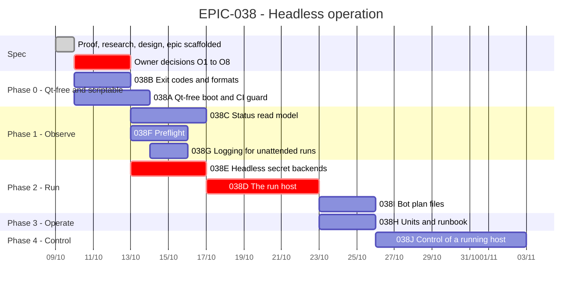

# EPIC-038 — Tracking

- **Epic:** [EPIC-038](README.md)
- **Status:** 🔵 Planned — not started (scaffolded as documentation; the owner decisions O1–O8 are pending)
- **Target Completion:** not set; each task is one pull request
- **Renders:** GitHub Markdown, VS Code Mermaid preview, or mermaid.live.

---

## 1. Schedule (Gantt)

---

## 2. Sub-tasks & PR Matrix

| Id | Sub-task | Branch / PR | Risk | Status | Target / Merged |
| :--- | :--- | :--- | :-: | :--- | :--- |
| EPIC-038A | [Qt-free boot and guard](completed/EPIC-038A_qt_free_boot_and_guard.md) | — | 🟡 | ✅ Done 2026-10-12 | — |
| EPIC-038B | [Exit codes and output formats](completed/EPIC-038B_exit_codes_and_output_formats.md) | `claude/epic-038b-exit-codes-reports` | 🟢 | ✅ Done 2026-10-12 | — |
| EPIC-038C | [Bot status read model](completed/EPIC-038C_bot_status_read_model.md) | `claude/epic-038c-status-read-model` | 🟡 | ✅ Done 2026-10-12 | — |
| EPIC-038D | [The run host](completed/EPIC-038D_run_host.md) | `claude/epic-038d-run-host` | 🔴 | ✅ Done 2026-10-13 | — |
| EPIC-038E | [Headless secret backends](completed/EPIC-038E_headless_secret_backends.md) | `claude/epic-038e-secret-backends` | 🔴 | ✅ Done 2026-10-13 | — |
| EPIC-038F | [Preflight command](completed/EPIC-038F_preflight_command.md) | `claude/epic-038f-preflight` | 🟡 | ✅ Done 2026-10-12 | — |
| EPIC-038G | [Logging for unattended runs](completed/EPIC-038G_logging_for_unattended_runs.md) | — | 🟡 | ✅ Done 2026-10-12 | — |
| EPIC-038H | [Service units and runbook](completed/EPIC-038H_service_units_and_runbook.md) | `claude/epic-038h-service-units` | 🟢 | ✅ Done 2026-10-13; checklist unsigned | — |
| EPIC-038I | [Bot plan files](completed/EPIC-038I_bot_plan_files.md) | `claude/epic-038i-bot-plan` | 🟡 | ✅ Done 2026-10-13 | — |
| EPIC-038J | [Control of a running host](completed/EPIC-038J_control_of_a_running_host.md) | `claude/epic-038j-control-running-host` | 🔴 | ✅ Done 2026-10-17; review round 1 pending | — |
| EPIC-038K | [Start on a running host](completed/EPIC-038K_start_on_a_running_host.md) | `claude/epic-038k-start-delete-running-host` | 🔴 | ✅ Done 2026-10-17; review pending | — |
| EPIC-038L | [Edit on a running host](completed/EPIC-038L_edit_on_a_running_host.md) | `claude/bot-edit-on-running-host-EPIC-038L` | 🔴 | ✅ Done 2026-10-17; review pending | — |
| EPIC-038M | [A Futures bot at host stop](completed/EPIC-038M_a_futures_bot_at_host_stop.md) | `claude/o12-futures-host-stop-policy` | 🔴 | ✅ Done 2026-10-20; review on the PR | — |

---

## 3. Milestone & Status Log

| Date | Item | Event & Outcome |
| :--- | :--- | :--- |
| 2026-10-20 | 038M | O12 implemented: the default stop leaves a Futures bot only under a covering stop on the exchange and closes the others (Stop with close); Spot unchanged; the read is bounded by half of `--stop-timeout`. |
| 2026-10-13 | 038I | `bot apply` / `bot export` and the plan file (`sew.bot-plan/1`, no secret field, identity name + venue), idempotent through the Bots tab's own commands; the applied desired states are recorded and `run --start-planned` reads them; no plan or a damaged record is exit 5 before anything boots. |
| 2026-10-13 | 038D | The `run` host delivered: signals, both stop policies (leave orders by default), the lock refusal (3), the pre-flight before the restore (4/5/6), the health line with a measured clock skew, `--start-planned` (waits for 038I's plan) and `--resume-recovering`. The log of a machine report moved to stderr; `stream_age_s` became `stream_down_s`. |
| 2026-10-13 | 038E | Systemd credentials and permission-checked files behind `ISecretStore`, read in one order with the source named; `ISecretStore` moved to `core/contracts`. The Windows ACL check and the Credential Manager are untested on a real server. |
| 2026-10-12 | 038C | Bot status read model, health snapshot (`state/health.json`), `status`, `bot list/show` delivered with the sections of bots, trading, market_data and the Engine's own check; D5 and D10 accepted as defaults. A read-only command must not be the writable copy (found, fixed). Clock skew stays `null` until 038D's host measures it (PR #470). |
| 2026-10-12 | 038F | `preflight` delivered: eight isolated checks, exit 0/4/5/6, the `declare_operations` registry, a gate for `run`. The exchange cannot report the address it sees; a `-2015` reply is the only source. |
| 2026-10-12 | 038B | Exit codes, the report renderers and the isolated CLI host (`support/cli_host`) delivered; a bare `main.py` prints help and exits 2. Four commands stopped exiting 0 on a failure; `--json` is pure stdout. |
| 2026-10-09 | Spec | Headless boot proven impossible without PySide6 (three UI concerns in `create_app`); epic scaffolded with ten children, a design, a research record and a decision record (no TUI). Documentation only. |

---

## 4. Blockers & Dependencies

| Blocker / Dependency | Impacted Tasks | Resolution / Owner | Status |
| :--- | :--- | :--- | :-: |
| Owner decisions O1 (resting orders at stop), O2 (resume after restart), O8 (mainnet on first release) | 038D | The owner answers; recommendations are in the decision record | 🟡 Open |
| Owner decision O3 (secret backend) — a backend that holds secrets is a security decision | 038E | Decided 2026-10-12 (§4a); the Windows Credential Manager under a service account is still unverified | 🟢 Decided |
| Owner decision O4 (control channel for a running host) | 038J | Answered "A" (a local command directory) on 2026-10-17 | 🟢 Decided |
| Owner decisions O5 (Windows supervisor), O6 (a headless requirements file — dependency change), O7 (Engine changes) | 038H, 038A, 038G | The owner answers | 🟡 Open |
| Alerting: bot events reaching the owner (`EPIC-036B`, `036C`) and the dead man's switch (`036E`) | the "supported unattended" claim of 038D and 038H | Land `EPIC-036` first, or ship without the claim | 🟡 Open |
| `ISecretStore` lift to `core/contracts` (`EPIC-036A`) | 038E | Done by 038E, first commit (decision D11) | 🟢 Done |
| The per-bot health snapshot of `EPIC-035W` (the owner asked that it not be started yet) | 038C | 038C ships bot state and reason from `ListBotsQuery`, and embeds the health later, in writing | 🟡 Open |
| `notification_event_handler.py` is deleted by `EPIC-036B` | 038A | 038A moves only the wiring; it does not rewrite the file | 🟡 Open |
