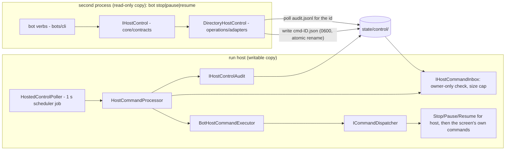
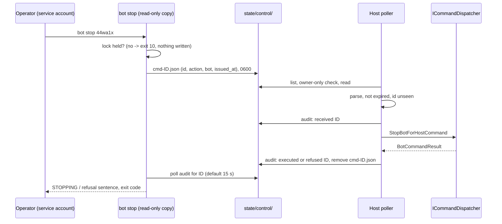

# EPIC-038J — Control of a running host: `bot stop`, `bot pause`, `bot resume` through a local command directory (channel A)

**Status:** ✅ Done (2026-10-17) — owner decision O4 answered **A** on 2026-10-17; re-scoped below; the reviewer's verdict is on the pull request
**Branch:** `claude/epic-038j-control-running-host`
**Source:** the owner, 2026-10-09; the research found that a second process is read-only by design (`EPIC-035H`) and a status needs no control, so *changing* what a live host runs is a separate security surface (R11). Re-opened 2026-10-17 by a live case (§1a).
**Risk:** 🔴 — a new path by which something can stop or start a bot; every documented mistake in the sources lives here
**Complexity:** L — a command source, authorisation, idempotency, audit
**Epic:** [EPIC-038](../README.md)
**SPEC:** SPEC-015 (new, 038D) is updated.
**Design:** [DESIGN §9](../DESIGN_2026-10-09_headless_operation.md) · **Research:** [§11](../RESEARCH_2026-10-09_headless_operation.md) · **Decision:** [O4](../DECISION_2026-10-09_headless_operation.md)
**Depends on:** 038D (done). **Re-scoped 2026-10-17:** `EPIC-036F` (Discord remote control) and `EPIC-035X` (the bot decision audit trail) **do not exist yet** and are no longer dependencies. Channel B (Discord) and channel C (a socket) are **not chosen** and not built. This task builds the smallest audit and authorisation channel A needs (§3), and nothing of `036F`'s allowlist or tiers; when `035X` or `036F` land they read the same ports (§3, "Extension cases").

---

## 1. Context and problem
In v1 the way to change what runs is to stop the host, `bot apply` and start it again — one path, nothing to authorise. If the owner wants to stop one bot on a live host from a shell, a command must cross from a second process into the first. The first is the writable copy; the second is read-only and may not place or cancel anything, which is exactly why a plain CLI cannot do it. The options (O4): none, a spool directory the host polls, a local socket or named pipe, or Discord only via `EPIC-036F`.

### 1a. The live case that re-opened it (2026-10-17)
The owner's Spot mainnet bot `44wa1x` (ETHUSDT) sat HALTED with reason `price_feed_stale`. A resume was refused because the owner had sold the ETH by hand. The owner wants it stopped and a fresh run started, and cannot: the headless host has no Stop, `bot` has only `list`, `show`, `apply` and `export`, the host holds the data-root lock so a second process is read-only, a HALTED bot counts as active (`other_active_bot.py`, ADR D20) so no new bot can start on that symbol, and `bot apply --prune` deletes only DRAFT or STOPPED bots.

### 1b. Owner decision O4 (recorded in the decision record, in the owner's words)
The owner asked for "stop and pause" on a running host and, after a plain-language explanation of three channels, answered **"A"**: the local command directory — one file per command, written only by the service account, read by the host, dispatched once through the same command handlers the desktop app uses, then removed and audited. Channels B (Discord) and C (a socket) are not chosen.

## 2. Acceptance criteria
- [x] Decision O4 is recorded, quoted, in `DECISION_2026-10-09_headless_operation.md` (§4b); this task builds **only** channel A. *Evidence:* the record; no Discord or socket code exists.
- [x] `bot stop <id>`, `bot pause <id>` and `bot resume <id>` reach a running host through the command directory. There is **one** implementation of each: the existing `StopBotCommand`, `PauseBotCommand`, `ResumeBotCommand`, reached through `ICommandDispatcher`. *Evidence:* `test_each_action_dispatches_its_contract_command_and_only_that`, `test_pausing_for_the_host_is_the_pause_the_screen_dispatches` (and the Stop twin in `test_host_bot_requests.py`), `test_a_running_bot_is_paused_and_resumed_from_the_command_directory`; mutation: mapping PAUSE to the stop command turned the composed-app test red.
- [x] A command takes effect **once**: its id is written to the audit before the dispatch, a second file with a seen id is refused as a replay, and a crash between the dispatch and the removal does not repeat it. *Evidence:* `test_the_same_file_offered_again_is_a_replay_and_changes_nothing`, `test_a_crash_after_the_audit_line_and_before_the_removal_does_not_repeat_the_command`, `test_the_command_is_audited_as_received_before_it_is_executed`, `test_the_audit_is_remembered_by_a_second_reader_and_by_a_restart`; mutations: removing the replay check and removing the `received` line each turned the processor tests red.
- [x] Every command is audited (received, then its verdict) in `control/audit.jsonl`, with id, action, bot, time; never a secret. *Evidence:* the processor tests above; the process test reads the audit of a real host (`received/refused` for the pause, `received/executed` for the stop).
- [x] Authority is the operating system's: the directory and each command file must be owner-only and the host account's own (the `EPIC-038E` checks reused); a file that fails is refused unread; an absent or unsafe directory means no control. *Evidence:* `test_a_command_file_other_accounts_can_touch_is_refused_unread` (0644, 0666, 0640), `..._owned_by_another_account_is_refused`, `..._in_a_directory_others_can_write_is_refused`, `test_a_symbolic_link_is_never_followed`, `test_an_oversized_file_is_refused`, `test_an_absent_directory_means_no_control`, `test_a_directory_owned_by_another_account_is_not_adopted`. **Not proven on Windows** (the ACL check is `EPIC-038E`'s, unrun on a Windows server).
- [x] No TCP port is opened: a test asserts the host's listening sockets are empty. *Evidence:* `test_a_second_process_stops_a_bot_on_the_running_host_and_the_host_listens_on_no_port` reads `/proc/<pid>/net/tcp*` for the real `run` child; `test_the_listening_socket_detector_sees_a_socket_this_process_listens_on` proves the detector finds a real listener. Linux only.
- [x] A malformed, replayed, expired or unauthorised command is logged at WARNING and refused without effect, and its file is removed. *Evidence:* `test_a_malformed_command_is_refused_without_effect`, `test_an_unauthorised_file_is_refused_unread_and_removed`, `test_a_command_must_be_written_recently_and_not_in_the_future` (the boundary values at and around 300 s and 60 s), `test_when_the_audit_cannot_be_written_nothing_is_executed`.
- [x] When no host is running the CLI says so plainly, exits 10 and changes nothing. *Evidence:* `test_with_no_host_running_the_verb_says_so_exits_ten_and_writes_nothing` (a real process; no control directory is made, nothing reached the exchange), `test_when_no_host_holds_the_lock_nothing_is_written`.
- [x] **End to end on the fake exchange:** a HALTED Spot bot whose base asset is gone is stopped through the command directory (STOPPED), and a new bot on that symbol can then be started. *Evidence:* `test_a_halted_bot_without_its_coin_is_stopped_from_the_command_directory_and_a_new_run_starts` (the coin is withdrawn from the fake account, the second bot is first refused with `ONE_RUNNING_BOT_DURING_FAST_TRACK`, then starts). **Found, then answered by the owner ("B"):** with the order session *closed* the screen's Stop waits in STOPPING; `bot stop` now opens it first. *Evidence:* `test_a_stop_while_the_order_session_is_closed_opens_it_and_the_bot_stops`, `test_stop_bot_for_operator.py` (mainnet needs the typed venue; nothing opened for a refused stop), and the real-process test, where the RECOVERING bot of a restarted host reaches STOPPED.
- [x] **Owns the remedy for decision O2:** a RECOVERING bot is resumed by `bot resume <id>` on the running host (mainnet needs `--confirm-venue`); the start warning names the command. *Evidence:* `test_resuming_a_paused_or_recovering_testnet_bot_is_the_screens_resume`, `test_a_recovering_mainnet_bot_is_not_resumed_until_the_venue_is_typed`, `test_a_recovering_mainnet_bot_with_its_venue_typed_carries_the_real_money_answer`, `test_host_steps.py` (`bot resume aaaaaa` in the WARNING). **Not run:** a RECOVERING resume against a live host in a process test (the in-process dispatch is proven; the order session opening it triggers is `BUG-204`'s, proven by `test_a_recovering_bot_resumes_from_the_desktop.py`).
- [x] Docs: SPEC-015, `headless_runbook.md`, the bots module design (`06-runtime.md`, `03-context.md`), the vocabulary, the epic README, `TRACKING.md`, the exit-code table, and this file say what is built and what is not.

## 3. Design

### 3.1 What is built, and what is not
| Piece | Decision |
| :--- | :--- |
| Channel | **A**, a local command directory: `<data root>/state/control/`. B and C are not built. |
| Verbs | `bot stop`, `bot pause`, `bot resume`. Not `start`, `delete`, `apply`: a verb is added by one class and one table row (§3.5), not now. |
| Who may issue | The account the host runs as. Authority is file permissions; there is no allowlist, no token, no password (nothing to leak). |
| Who listens | The `run` host only (a hosted service registered by `RunCommand`). The desktop app and a read-only copy never read the directory. |
| `bot resume` on a HALTED bot | **Refused with words**: a HALTED resume proposes a ladder a person reads and confirms (D13), which a file cannot do. It is `run --resume-halted` or the Bots tab. `bot resume` covers PAUSED and RECOVERING. |
| Audit | The smallest one: an append-only JSON-lines file next to the commands. `EPIC-035X` will read the same port (`IHostControlAudit`) when it lands. |
| Tiers, allowlists | `EPIC-036F`'s concern (remote users). Here the only principal is the service account, so nothing is tiered: Stop is as authorised as Pause. |

### 3.2 Components (module `operations`, plus the verbs in `bots`)

`IHostControl` is a **core contract** because `bots` (which owns the `bot` command) may not import `operations`, which depends on `bots`; the request type and the port are the whole of what crosses. The processor depends on three ports (inbox, audit, executor) and a clock, so its tests use no file and no sleep.

### 3.3 Sequence

A timeout does not leave a hidden command: the CLI tries to remove its own file; if that succeeds the host never took it ("withdrawn, nothing happened"); if the file is gone the host took it and the CLI waits a little longer and then says the outcome is unrecorded.

### 3.4 Failure modes
| Case | Result |
| :--- | :--- |
| Directory absent / not owner-only / owned by another account | no control; one ERROR at host start; the CLI exits 5 saying why |
| File mode 0644, owned by another account, a symlink, too large, not UTF-8 | refused unread, WARNING, removed, audited as unauthorised/malformed |
| Valid JSON of another schema, unknown key, bad id, unknown action | malformed |
| `issued_at` older than 5 min or more than 1 min ahead | expired |
| Same command id again (a replay, or a crash between audit and removal) | replay, not executed |
| The bot's own gate says no (not found, invalid transition, read-only, real money not confirmed) | `refused` with the screen's sentence; CLI exits 2 |
| The handler raises | `failed`, logged with the traceback; the poller carries on |
| Host stopping while a file waits | stays in the directory; it expires, never runs late |

### 3.5 Extension cases
```text
@par Extension cases
  · a new verb (`bot start`) - one HostControlAction member, one contract command + handler in bots,
    one row in the executor's table, one verb class and its cli_commands.json entry;
  · a new transport (Discord `EPIC-036F`, a socket) - another producer of HostCommand fed to the
    same HostCommandProcessor, so replay, expiry, audit and execution are not rebuilt;
  · the bot decision audit (`EPIC-035X`) - another IHostControlAudit implementation, or a reader of
    the JSON-lines file; the processor does not change;
  · Windows - the inbox takes its permission checks as a list; the ACL check is already there.
```

## 3a. Reuse
| Need | What was used |
| :--- | :--- |
| Run a command from anywhere that holds no handler | `ICommandDispatcher`; the host-side contract commands follow `StartBotForHostCommand`/`StopBotForHostCommand` (038D) |
| Believe a file only if the OS vouches for it | `ISecretFileCheck` (`PosixSecretFilePermissionCheck`, `WindowsSecretFilePermissionCheck`, `EPIC-038E`), lent to the inbox through `IControlFileCheck` in `operations/composition/` (the only place of a module that may import `support/secrets`); the open-once, no-follow, read-the-descriptor shape of `PermissionCheckedFileStore` |
| Is a host running | `IInstanceProbe` (`status`'s lock probe) |
| A periodic job inside the host | the Engine `Scheduler`, as `HealthPublishing`; an `IHostedService` registered by `RunCommand`, as `HostedRunHost` |
| Print a result, in text or JSON | `Report` and `IReportPrinter` |
| Exit codes | `ExitCode.HOST_NOT_RUNNING` (10), `HOST_UNHEALTHY` (11), `CONFIGURATION` (5), `USAGE` (2) with their meanings widened in the table |
| The screen's Pause/Resume/Stop with their refusals | `PauseBotCommand`, `ResumeBotCommand`, `StopBotCommand`; `BotLookup`; `RESUME_PROPOSES_STATES` |
| Doubles | derived from the ABCs (`IHostCommandInbox`, `IHostControlAudit`, `IHostCommandExecutor`, `IOperationsClock`, `IInstanceProbe`, `IHostControl`, `ICommandDispatcher`); the audit and the inbox are also tested as the real files |
| Not reused, and why | the alert outbox (a SQLite queue of outbound messages, not a record of inbound commands); `EPIC-036F`'s allowlist and tiers (not built; the only principal here is the service account) |

## 4. Changes, per file
| File | Change |
| :--- | :--- |
| `src/core/contracts/host_control.py` (new) | `HostControlAction`, `HostControlRequest`, `HostControlStatus`, `HostControlReply`, `IHostControl` |
| `src/modules/operations/contracts/host_command.py`, `i_host_command_inbox.py`, `i_host_control_audit.py`, `i_host_command_executor.py` (new) | the wire command, the three ports |
| `src/modules/operations/application/host_command_codec.py`, `host_command_processor.py`, `bot_host_command_executor.py` (new) | strict parse/encode; the poll (expiry, replay, audit, execute, discard); the mapping to the bots' contract commands |
| `src/modules/operations/adapters/directory_host_command_inbox.py`, `jsonl_host_control_audit.py`, `directory_host_control.py`, `hosted_control_poller.py` (new) | the filesystem halves: host side, audit, CLI side, the hosted service |
| `src/modules/operations/composition/control_bindings.py` (new), `module.py`, `cli/run_command.py` | binding; `run` registers the poller |
| `src/modules/bots/contracts/host_bot_requests.py`, `application/use_cases/pause_bot_for_host/`, `resume_bot_for_host/`, `composition/command_bindings.py` | the two new host commands and their handlers |
| `src/modules/bots/cli/bot_control_verbs.py` (new), `bot_verbs.py`, `bot_verb_world.py`, `bot_cli_handler.py`, `src/config/cli_commands.json` | the three verbs and their entries (`read_only`: the CLI process changes nothing itself) |
| `src/modules/operations/application/host_steps.py` | the RECOVERING warning names `bot resume` |
| `src/support/cli_host/exit_code_table.py`, `Docs/OPERATIONS/exit_codes.md` | exit 10 / 11 also used by the control verbs |
| Docs | SPEC-015, `headless_runbook.md`, `Docs/MODULES/…`, `Docs/VOCABULARY/README.md`, the epic README and `TRACKING.md`, the decision record (O4) |

## 5. Testing
Written first; each must fail for the right reason before the code exists.
- **Unit, processor** (fakes for inbox, audit, executor, clock): executes once; replay refused; expired and future-dated refused; malformed variants; unauthorised entry refused; audit order (received before executed); an executor that raises is `failed` and the next command still runs; a discard that fails is not retried forever.
- **Unit, codec**: round trip; every malformed variant (type, unknown key, id shape, huge bot id, wrong schema).
- **Unit, adapters on `tmp_path`**: inbox accepts an owner-only file, refuses 0644, a symlink, an oversize file, a directory with group-write, a foreign owner (the check injected); audit survives a reopen and `has_seen` reads it; client writes atomically with mode 0600, withdraws on timeout, reports `NOT_RUNNING` writing nothing.
- **Unit, verbs**: the three verbs map each reply status to the exit code and the sentence; `--confirm-venue`; `--json`.
- **Unit, bots**: `PauseBotForHost` / `ResumeBotForHost` dispatch the screen's command; a HALTED resume is refused with words; mainnet RECOVERING without the venue is refused.
- **Parity**: the host-side commands and the Bots presenter reach the same handler class.
- **Integration, fake exchange (the case that must work):** a HALTED Spot bot whose base asset is gone → `bot stop` through the real directory and the real processor → STOPPED → a new bot on the symbol starts.
- **Integration, process:** `run` as a child with control on; a second process runs `bot pause`; the host's listening sockets are empty. (Fake exchange only; no mainnet.)
- **Architecture guards** run as for any change.
Not run yet.

## 6. Docs touched
`Docs/SPEC/SPEC-015_run_the_bots_headless.md` (§3a, the "does not promise" bullet, §5 rows, §7, §8), `Docs/OPERATIONS/headless_runbook.md` (§0, §6 "Control one bot on the running host", §8), `Docs/OPERATIONS/exit_codes.md` (generated), `Docs/MODULES/bots/03-context.md` and `06-runtime.md`, `Docs/VOCABULARY/README.md` (host control, command directory, host command, control audit), the decision record (§4b, evidence rows), the epic `README.md` and `TRACKING.md`, `Tasks/epics/README.md`. There is no `Docs/MODULES/operations/` folder, so the operations half of the design is in this file's §3 and in SPEC-015.

## Implementation notes (written when done)
**Decisions the records did not settle** (the owner may veto; grounded in O4 = A, P5, P7):
1. **Opt-in by process, not by flag.** Only `run` registers the poller (`HostedControlPoller`); the desktop app and a read-only copy never read the directory. There is no `--no-control` flag: control is on for every `run` host, and the directory permission is the switch (nobody but the service account can write it). A flag is one line if the owner wants it.
2. **At most once, not exactly once.** The `received` line is written before the dispatch, so a host that dies in between refuses the command as a replay on its next start; the operator then sees `NO_ANSWER` and checks `bot show`. The alternative (write the verdict after, re-run on a missing verdict) could stop a bot twice or resume it twice.
3. **A command expires after 5 minutes** (and is refused when dated more than 1 minute ahead of the host's clock): a file that sat while the host was down must not run later, out of context.
4. **A timeout withdraws the command** when the host never took it (the writer removes its own file); if the file is gone the host took it and the reply says the outcome is unrecorded. No command is left hidden.
5. **`bot resume` does not resume HALTED or AWAITING_RECOVERY.** That resume proposes a ladder a person reads and confirms (D13); a file cannot confirm. The refusal names `run --resume-halted` and the Bots tab.
6. **`bot stop` opens a closed order session (owner's answer "B", 2026-10-17).** Found while building the owner's case: the screen's Stop does not open it, so after an Emergency Stop or a restart a stop waited in STOPPING for a session nobody opens. `StopBotForOperatorCommand` opens it (mainnet: only with `--confirm-venue`, asked only when the session is closed) then dispatches `StopBotForHostCommand`; the shutdown policy and the desktop Stop are unchanged. Opening the session reconciles every bot on the venue, as Start and Resume do.
7. **The three verbs are declared `read_only`** in `cli_commands.json`: this process changes nothing itself; the host changes the bot. The entry point therefore takes no lock for them.
8. **Exit codes:** DONE 0; the bot's refusal 2; the host's refusal of the file itself 1; no control 5; no host 10; no answer 11.
9. **Audit lines never hold a secret or a free-text echo of the file:** a malformed file is reported by reason, not by content; a handler that raises is reported by its exception type.

**Findings the task text lacked:** `EPIC-036F` and `EPIC-035X` do not exist (re-scoped, see the header). `bots` may not import `operations`, so the port the verbs use is in `core/contracts` (`IHostControl`). `operations` may not import `support/secrets` outside `composition/`, so the permission checks arrive through `IControlFileCheck`. The seeded RECOVERING bot of the existing process tests has no run, so a Stop of it ends in ERROR (`has no run to register a budget for`); the new process test seeds a bot with a run. Qt's system libraries (`libegl1`...) had to be installed in this container before pytest could start.

**Not done / not proven:** Windows (the ACL check and the directory inheritance); a real systemd unit; any exchange but the fake. Channels B and C. `bot start`, `delete`, `apply` through control. An allowlist, tiers, rotation of `audit.jsonl`.

## Resume
Done in the pull request for branch `claude/epic-038j-control-running-host`. The reviewer's verdict (round 1) is on that pull request; nothing else is open in this task.
