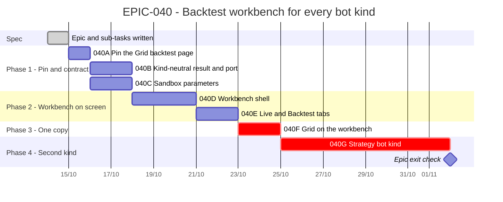

# EPIC-040 — Tracking

- **Epic:** [EPIC-040](README.md)
- **Status:** 🔵 Planned (not started at the owner's request)
- **Target Completion:** not scheduled
- **Renders:** GitHub Markdown, VS Code Mermaid preview, or mermaid.live.

---

## 1. Schedule (Gantt)

Not scheduled: the owner asked for the plan only. The bars show the dependency order and an estimate in working days.

---

## 2. Sub-tasks & PR Matrix

| Id | Sub-task | Branch / PR | Risk | Status | Target / Merged |
| :--- | :--- | :--- | :-: | :--- | :--- |
| EPIC-040A | [Pin the Grid backtest page](incomplete/EPIC-040A_pin_grid_backtest_behaviour.md) | — | 🟢 | 🔵 Planned | — |
| EPIC-040B | [Kind-neutral result and simulator port](incomplete/EPIC-040B_kind_neutral_backtest_contract.md) | — | 🟡 | 🔵 Planned | — |
| EPIC-040C | [Sandbox parameters](incomplete/EPIC-040C_sandbox_parameters.md) | — | 🟡 | 🔵 Planned | — |
| EPIC-040D | [Backtest workbench shell](incomplete/EPIC-040D_backtest_workbench_shell.md) | — | 🟡 | 🔵 Planned | — |
| EPIC-040E | [Live and Backtest centre tabs](incomplete/EPIC-040E_live_and_backtest_tabs.md) | — | 🟡 | 🔵 Planned | — |
| EPIC-040F | [Grid on the workbench, duplicate deleted](incomplete/EPIC-040F_grid_on_the_workbench.md) | — | 🔴 | 🔵 Planned | — |
| EPIC-040G | [Strategy bot kind](incomplete/EPIC-040G_strategy_bot_kind.md) | — | 🔴 | 🔵 Planned | — |

---

## 3. Milestone & Status Log

| Date | Item | Event & Outcome |
| :--- | :--- | :--- |
| 2026-10-14 | Spec | Epic scaffolded, six sub-tasks written with design assessments; parked at the owner's request. |
| 2026-10-14 | Spec | `040G` added: the strategy bot as a kind of its own, moved from `EPIC-029L`. |

---

## 4. Blockers & Dependencies

| Blocker / Dependency | Impacted Tasks | Resolution / Owner | Status |
| :--- | :--- | :--- | :--- |
| The owner's go-ahead and the §1 decisions | All | The owner | 🟡 Open |
| Whether the Engine's workbench region host offers a tabbed centre | 040E | Read the Engine's `WorkbenchSurface` first; a stock `QTabWidget` in the centre region otherwise | 🟡 Open |
