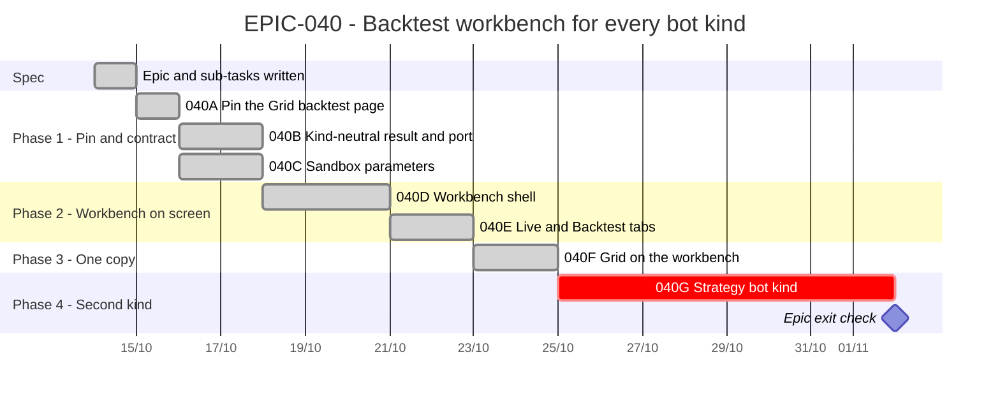

# EPIC-040 — Tracking

- **Epic:** [EPIC-040](README.md)
- **Status:** 🟡 In progress (phase 1, `040A`–`040C`, and `040D`, `040E`, `040F` done; un-parked 2026-10-20)
- **Target Completion:** not scheduled
- **Renders:** GitHub Markdown, VS Code Mermaid preview, or mermaid.live.

---

## 1. Schedule (Gantt)

Not scheduled: the owner asked for the plan only. The bars show the dependency order and an estimate in working days.

---

## 2. Sub-tasks & PR Matrix

| Id | Sub-task | Branch / PR | Risk | Status | Target / Merged |
| :--- | :--- | :--- | :-: | :--- | :--- |
| EPIC-040A | [Pin the Grid backtest page](completed/EPIC-040A_pin_grid_backtest_behaviour.md) | `claude/epic-040a-pin-grid-backtest` | 🟢 | ✅ Done | 2026-10-20 |
| EPIC-040B | [Kind-neutral result and simulator port](completed/EPIC-040B_kind_neutral_backtest_contract.md) | `claude/epic-040b-kind-neutral-backtest` | 🟡 | ✅ Done | 2026-10-20 |
| EPIC-040C | [Sandbox parameters](completed/EPIC-040C_sandbox_parameters.md) | `claude/epic-040c-sandbox-parameters` | 🟡 | ✅ Done | 2026-10-20 |
| EPIC-040D | [Backtest workbench shell](completed/EPIC-040D_backtest_workbench_shell.md) | `claude/epic-040d-backtest-workbench` | 🟡 | ✅ Done | 2026-10-20 |
| EPIC-040E | [Live and Backtest centre tabs](completed/EPIC-040E_live_and_backtest_tabs.md) | `claude/epic-040e-live-and-backtest-tabs` | 🟡 | ✅ Done | 2026-10-20 |
| EPIC-040F | [Grid on the workbench, duplicate deleted](completed/EPIC-040F_grid_on_the_workbench.md) | `claude/epic-040f-grid-on-the-workbench` | 🔴 | ✅ Done | 2026-10-20 |
| EPIC-040G | [Strategy bot kind](incomplete/EPIC-040G_strategy_bot_kind.md) | — | 🔴 | 🔵 Planned | — |

---

## 3. Milestone & Status Log

| Date | Item | Event & Outcome |
| :--- | :--- | :--- |
| 2026-10-14 | Spec | Epic scaffolded, six sub-tasks written with design assessments; parked at the owner's request. |
| 2026-10-14 | Spec | `040G` added: the strategy bot as a kind of its own, moved from `EPIC-029L`. |
| 2026-10-20 | Start | Un-parked by the owner; phase 1 (`040A`–`040C`) first. |
| 2026-10-20 | 040G | Design written as a Proposed decision record (five slices, backtest first, Testnet only); waits for the owner's answers O1–O4. |
| 2026-10-20 | 040F | The Grid's own backtest page, presenter and coordinator are deleted; the Grid runs on the workbench alone (net −1,429 source lines). |
| 2026-10-20 | 040E | The Bots centre's Live and Backtest tabs; one workbench per venue; the bottom Backtest dock is gone. |
| 2026-10-20 | 040D | The workbench page for any kind, run through `RunBacktestQuery`; a stub second kind renders through it. Not on screen until `040E`. |
| 2026-10-20 | 040C | Sandbox plan, session rule, judging with no account, and the no-command guard; phase 1 complete. |
| 2026-10-20 | 040B | Kind-neutral outcome, port and the Grid's adapter; nothing draws the outcome yet. |
| 2026-10-20 | 040A | Thirteen frames and one test per state of the Grid backtest page; no behaviour changed. |

---

## 4. Blockers & Dependencies

| Blocker / Dependency | Impacted Tasks | Resolution / Owner | Status |
| :--- | :--- | :--- | :--- |
| The §1 decisions | 040D onward | The owner approved all five on 2026-10-20 (recorded in the epic's §1) | ✅ Resolved |
| Whether the Engine's workbench region host offers a tabbed centre | 040E | It does not; a stock `QTabWidget` is the centre (`BotsView.centre`) | ✅ Resolved |
