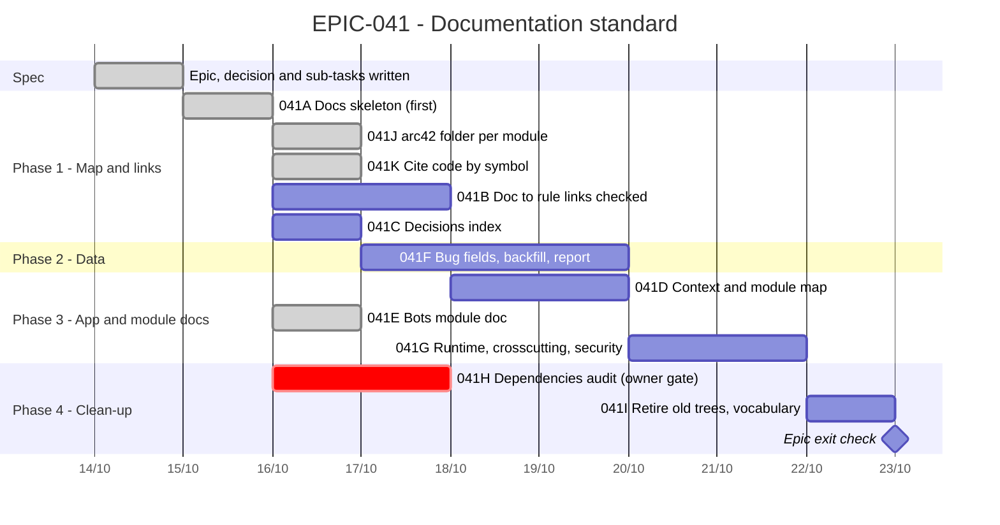

# EPIC-041 — Tracking

- **Epic:** [EPIC-041](README.md)
- **Status:** 🔵 Planned
- **Target Completion:** not scheduled
- **Renders:** GitHub Markdown, VS Code Mermaid preview, or mermaid.live.

---

## 1. Schedule (Gantt)

Estimates in working days; the order follows the dependencies in the README.

---

## 2. Sub-tasks & PR Matrix

| Id | Sub-task | Branch / PR | Risk | Status | Target / Merged |
| :--- | :--- | :--- | :-: | :--- | :--- |
| EPIC-041A | [Docs skeleton](completed/EPIC-041A_docs_skeleton.md) | `claude/epic-041a-docs-skeleton` | 🟢 | ✅ Done | 2026-10-14 |
| EPIC-041J | [arc42 folder per module](completed/EPIC-041J_module_folder_layout_and_design_in_step.md) | — | 🟡 | ✅ Done | 2026-10-16 |
| EPIC-041K | [Cite code by symbol](completed/EPIC-041K_cite_code_by_symbol.md) | `claude/epic-041k-cite-code-by-symbol` | 🟡 | ✅ Done | 2026-10-16 |
| EPIC-041B | [Doc to rule links checked both ways](incomplete/EPIC-041B_doc_rule_links_checked_both_ways.md) | — | 🟡 | 🔵 Planned | — |
| EPIC-041C | [Decisions index](incomplete/EPIC-041C_decisions_index.md) | — | 🟢 | 🔵 Planned | — |
| EPIC-041D | [App context and module map](incomplete/EPIC-041D_app_context_and_module_map.md) | — | 🟡 | 🔵 Planned | — |
| EPIC-041E | [Bots module doc](completed/EPIC-041E_bots_module_doc.md) | `claude/epic-041e-bots-module-folder` | 🟡 | ✅ Done | 2026-10-16 |
| EPIC-041F | [Quality metrics data](incomplete/EPIC-041F_quality_metrics_data.md) | — | 🟡 | 🔵 Planned | — |
| EPIC-041G | [Runtime, crosscutting, security, quality](incomplete/EPIC-041G_runtime_crosscutting_security_quality.md) | — | 🟡 | 🔵 Planned | — |
| EPIC-041H | [Dependency register, audit, licences](incomplete/EPIC-041H_dependency_register_audit_licences.md) | — | 🟡 | 🔵 Planned | — |
| EPIC-041I | [Retire old trees, guard vocabulary](incomplete/EPIC-041I_retire_hld_sdd_and_guard_vocabulary.md) | — | 🟢 | 🔵 Planned | — |

---

## 3. Milestone & Status Log

| Date | Item | Event & Outcome |
| :--- | :--- | :--- |
| 2026-10-14 | Spec | Epic scaffolded with nine sub-tasks and the documentation-philosophy decision. |
| 2026-10-14 | 041A | Documentation skeleton delivered: map, status lines, four homes, `bots` skeleton, "Docs touched" rule. |

---

## 4. Blockers & Dependencies

| Blocker / Dependency | Impacted Tasks | Resolution / Owner | Status |
| :--- | :--- | :--- | :--- |
| The owner's approval for a workflow and tooling change | 041H | The owner | 🟡 Open |
