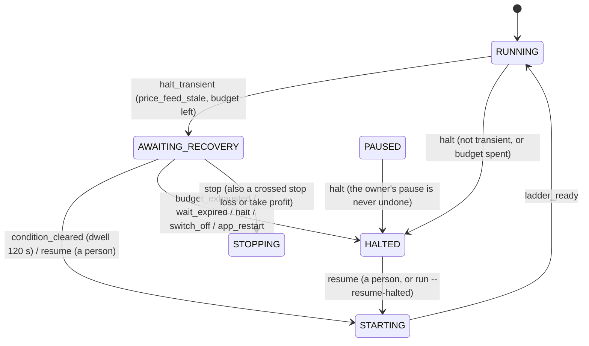

# ADR — A bot halted by a transient cause waits in its own state, recovers by itself through the Resume path, and the owner can resume HALTED bots on the host

**Epic:** [EPIC-042](README.md)
**Date:** 2026-10-17
**Status:** Accepted (D1–D6 by the owner; D7–D12 are agent decisions the owner may veto, §2)
**Decided by:** the owner, 2026-10-17, through the coordinating session (quoted once in the epic README); the rest by the author session under `ONBOARDING.md` §7
**Supersedes / superseded by (optional):** none. It extends [ADR 029 §3.1](../EPIC-029_bots_tab_grid_fast_track/DECISION_2026-10-03_bots_module_and_grid_bot.md) (the lifecycle) and [ADR 038 O2](../EPIC-038_headless_operation/DECISION_2026-10-09_headless_operation.md) (a host never resumes a bot by itself).

| Label | Meaning |
| :--- | :--- |
| ✅ Established | confirmed on the code tree at `5a2d0eb` (`master-warrior`, 2026-10-17); cited by path and symbol |
| 🟢 User decision | decided by the owner, relayed by the coordinating session |
| 🤖 Agent decision | decided by the author session under `ONBOARDING.md` §7; the owner may veto, and a veto changes one table row or one constant |
| ❓ Open | blocks the named phase until answered |

## 1. Context

A Spot mainnet Grid on the headless VPS host halted on 2026-10-17 with `price_feed_stale` (no tick for more than 60 s). The feed was back within minutes (`tick_age_s=1`) and the bot stayed `HALTED`. Every network blip over 60 s parks a real-money bot until a person acts.

**Established facts**

- ✅ The halt is `GridPriceReaction.check_age` → `halt_with(state, GridReason.PRICE_FEED_STALE, detail)` (`bots/application/kinds/grid/watch/grid_price_reaction.py`), which applies `halt` through `BotRunState.apply_or_record`. `GridTaskGuard`/`grid_parking.py` then take the ladder off the exchange and keep the bought base. The check runs on the price watch's beat (`IBotFacts.on_price_age_check`, posted by `GridFacts`).
- ✅ `HALTED` has one way back: `resume` → `STARTING` (`BOT_LIFECYCLE_TRANSITIONS`). The person's Resume is two steps in `GridResumeSequence` (`bots/application/kinds/grid/recovery/grid_resume_sequence.py`): `propose` registers the budget from exchange evidence, cancels every tagged order and sizes a new ladder from the price now and the inventory held; `confirm` re-reads the price, applies `resume` and lays the ladder.
- ✅ The Grid already resumes by itself in one case: a rate-limit halt (`GridRateLimitPause`, `MAX_AUTO_RESUMES`) runs `propose` then `confirm` when the exchange's named pause ends.
- ✅ The headless host cannot resume a `HALTED` bot: `run` has `--resume-recovering` (`RunOptions.resume_recovering`, `ResumeRecoveringForHostCommandHandler`), which only opens the venue's order session so the bots in `RECOVERING` reconcile; the `bot` verbs are list, show, apply and export.
- ✅ A stop loss or take profit is watched in `HALTED` (`_WATCHES_EXITS` in `grid_price_reaction.py`): a tick whose range reaches either runs Stop with *sell base* forced.
- ✅ `Bot` persists `BotLifecycle` (state, `run_started_at`, `recovering_from`) in the bot file (`bots/adapters/persistence/bot_record_codec.py`); `GridRuntime.reason` / `reason_detail` carry the halt's cause.
- ✅ Alerting reads the bot store's `BotChangedEvent` and alerts on entering `HALTED` or `ERROR` (`BotAlertSource.ALERT_ON_ENTRY`); a bot's own fact that is not a state arrives as a contract event (`BotStopGaveUpEvent`).

**Forces.** A halt that closes nothing and cancels only the ladder is safe to leave for minutes; it is unsafe to leave for hours (the base is unprotected, `EPIC-039` §1). The cure for the owner's incident must not become a loop that re-lays a real-money ladder into a market whose feed keeps failing, and must not undo a decision a person made.

## 2. Decisions

| # | Decision | Status | Decided by | Consequence |
| :-- | :--- | :--- | :--- | :--- |
| D1 | **Automatic recovery after a transient halt.** The cause must stay clear for a **dwell of 120 s, continuously**; then the bot resumes through the **same propose-and-confirm path a person's Resume uses**. If that path finds the stop loss or take profit crossed, the bot ends as that path already decides (Stop, *sell base* forced); it never continues blindly. **At most 3 automatic recoveries per rolling 24 h.** When they are used up the bot stays `HALTED` for a person. Each automatic recovery and the exhaustion raise an alert through the existing alerting module. | 🟢 Accepted | Owner, 2026-10-17 | The owner's incident heals in about three minutes without a person; a feed that keeps failing costs three tries and then pages the owner. |
| D2 | **`run --resume-halted`**, mirroring `--resume-recovering`: the owner resumes `HALTED` bots on the host. | 🟢 Accepted | Owner, 2026-10-17 | The headless host gets the missing person's Resume. Shape in D13. |
| D3 | **A real state, `AWAITING_RECOVERY`**, in the lifecycle table with its own events and transitions, never an `if` on `HALTED`. Named here and in `Docs/VOCABULARY` (D14). | 🟢 Accepted (name 🤖) | Owner; name: author | Every consumer of the state (UI, status report, alerts, restart rule, exit watch) answers for it through the table, so none can forget it. |
| D4 | **A general mechanism in the bots module's shared lifecycle/application layer, behind a seam.** Which halt reasons are transient, with what dwell and budget, is **plain data composed from three layers** (D15): common, kind, venue. A probe per reason says whether it has cleared (`IHaltConditionProbe`). The attempt history is **persisted in the bot record** (`BotLifecycle.recovery_attempts`), so a restart keeps the 24 h budget. | 🟢 Accepted (shapes 🤖) | Owner; shapes: author | A second kind, venue or reason is one entry in one layer; the table, the director and the persistence do not change (§5). |
| D5 | **Spot keeps the common set, with `price_feed_stale` and `user_stream_down`; Futures removes every reason for now**: its halt closes the position and `EPIC-039L` governs it. In the layers this is one line, the Futures venue layer's `clears_lower_layers`. | 🟢 Accepted | Owner, 2026-10-17 | No Futures file changes beyond that one declaration; opening Futures later deletes that line. A test locks that a Futures venue resolves no rule. |
| D6 | **The grid rate-limit auto-resume is not migrated in this epic.** Follow-up [`EPIC-042F`](incomplete/EPIC-042F_migrate_rate_limit_resume.md). Reasons in §3. | 🟢 Accepted (follow-up) | Owner asked to record it; author judged it not trivial | `GridRateLimitPause` keeps its own counter and timer until then; the two compose (an attempt that meets a limit lands in `HALTED` with `RATE_LIMITED`, and the pause resumes it). |
| D7 | **Events and transitions are the table of §2.1.** Four new events (`halt_transient`, `condition_cleared`, `budget_exhausted`, `wait_expired`), one new state. A person's `resume` is also declared from the new state, so the owner can end the wait. | 🤖 Agent | Author | One screen of new rows in `bot_lifecycle_fsm_matrix.py`; the generated tables follow. |
| D8 | **Only `RUNNING`, `STARTING` and `RECOVERING` (whose prior state is `RUNNING`) halt transiently. A `PAUSED` bot, and a `RECOVERING` bot that came from `PAUSED`, halt plainly.** The owner's Pause is an intent to not trade; an automatic recovery would undo it. The choice between `halt` and `halt_transient` is made in one place (`HaltRecoveryDirector`), not in the table: the table has no `PAUSED` + `halt_transient` cell, so the wrong event is refused even if a caller asks. | 🤖 Agent | Author | Tested by the table (no cell) and by the director (the event it picks for each state). |
| D9 | **A restart answers `AWAITING_RECOVERY` with `HALTED`** (`app_restart` row), keeping the reason and the persisted attempt ledger. A restart is not a person's confirmation (ADR 029 D12: nothing at start places an order), the dwell is measured on one process's clock and a venue's order session is closed after a restart, so the resume path could not run. The owner then uses `run --resume-halted` or the GUI. Alternative (stay and wait out a fresh dwell) is in §3. | 🤖 Agent, **owner may veto** (it changes one table row) | Author | A VPS unit restart during a feed outage parks the bot as it does today; nothing places an order on its own. |
| D10 | **An attempt is counted when it starts (the dwell has elapsed), not when it succeeds.** The entry is saved before `propose` runs. A failed attempt (the proposal refused, the price moved, the symbol not trading) costs budget, so a flapping market ends at three tries. | 🤖 Agent | Author | The ledger cannot be under-counted by a crash between `propose` and `confirm`; the cost is that a refused attempt spends one of the three. |
| D11 | **A wait limit: `max_wait` (15 min for `price_feed_stale`).** A bot still in `AWAITING_RECOVERY` after it → `wait_expired` → `HALTED`, which raises the existing `BOT_HALTED` alert. Without it a feed that never returns leaves a real-money bot silent (no entry into `HALTED`, so no alert) while its stop loss is unwatched. | 🤖 Agent (a gap in the owner's rule), **owner may veto** | Author | One constant per rule. The owner's three-per-24 h budget is unchanged. |
| D12 | **Exits stay watched while waiting.** `AWAITING_RECOVERY` joins `_WATCHES_EXITS` and, through `PRICE_STREAM_STATES`, keeps the bot's price stream. Each attempt re-checks the stop loss and take profit on the fresh price **before** `propose`, and ends as Stop when crossed. A price that crossed and came back during a feed outage, with no tick heard, cannot be seen by anything; that is true of a person's Resume as well and is stated, not hidden. | 🤖 Agent | Author | The "never blindly continues" clause of D1 is a test (`EPIC-042C`), not a sentence. |
| D13 | **`--resume-halted` is the person's Resume and Confirm, answered in advance on the command line.** For each bot in `HALTED` or `AWAITING_RECOVERY` it dispatches `ResumeBotCommand` (the real-money answer carried only when `--confirm-venue` names the bot's own venue, as `StartBotForHostCommandHandler` judges it for Start) and, once the executor holds the proposal (`IBotRunner.has_resume_proposal`), `ConfirmBotResumeCommand`, so the ladder is the one the GUI would propose and the price is re-read before it is laid. It opens the order session through `order_session_refusal_words`, the one place a deliberate action does. No other state is touched. Like `--resume-recovering` it is refused on a host with no alert channel (the existing "nobody watching" check). The owner does not review the proposal on a headless host; that is the same trust D1 gives the automatic path, and the proposal's price tolerance (`RESUME_PRICE_TOLERANCE`) still applies. | 🤖 Agent | Author | Detailed in `EPIC-042E`; the exit codes follow `Docs/OPERATIONS/exit_codes.md`. |
| D14 | **Vocabulary.** *Awaiting recovery*, *Halt recovery rule*, *Recovery attempt* are defined once in `Docs/VOCABULARY/README.md` and distinguished there from *Recovering bot* (the restart's reconcile), the name that most invites confusion. | 🤖 Agent | Author | See alternatives for the name. |
| D15 | **Layered policy, merged as data** (the owner, relayed 2026-10-17: *recoverable halt reasons must be layered, with common reasons and kind- or venue-specific reasons … compose policy layers, not class inheritance … the effective policy is the merge of these three layers … plain data … the effective table can be printed*). Layers, merge rule, precedence and the reason classification are §2.3. | 🟢 Accepted (shapes 🤖) | Owner; shapes: author | The effective table is testable per layer and merged, printed by `bot show` (`EPIC-042G`) and in the module design (generated). |

### 2.1 The new state, its events and its transitions

**One state:** `AWAITING_RECOVERY` — halted by a cause the kind named transient, orders off the exchange, base kept, exits watched, waiting for the cause to stay clear for the dwell.

**Four events**

| Event | Meaning |
| :--- | :--- |
| `halt_transient` | A halt whose reason the effective policy names recoverable, with budget left. |
| `condition_cleared` | The probe has said *clear* continuously for the dwell; the attempt is saved and the resume path runs. Its `confirm` applies this event instead of `resume`. |
| `budget_exhausted` | An attempt did not return the bot to `STARTING` and the rolling budget is spent. |
| `wait_expired` | `max_wait` elapsed in the state. |

**Rows added to `BOT_LIFECYCLE_TRANSITIONS`** (nothing else in the table changes except what D9 states):

| From | Event | To |
| :--- | :--- | :--- |
| `STARTING` | `halt_transient` | `AWAITING_RECOVERY` |
| `RUNNING` | `halt_transient` | `AWAITING_RECOVERY` |
| `RECOVERING` | `halt_transient` | `AWAITING_RECOVERY` |
| `AWAITING_RECOVERY` | `condition_cleared` | `STARTING` |
| `AWAITING_RECOVERY` | `resume` (the person's) | `STARTING` |
| `AWAITING_RECOVERY` | `budget_exhausted` | `HALTED` |
| `AWAITING_RECOVERY` | `wait_expired` | `HALTED` |
| `AWAITING_RECOVERY` | `halt` (another cause, or the attempt's own refusal) | `HALTED` |
| `AWAITING_RECOVERY` | `stop` | `STOPPING` |
| `AWAITING_RECOVERY` | `switch_off` (Emergency Stop, trading off) | `HALTED` |
| `AWAITING_RECOVERY` | `fault` | `ERROR` |
| `AWAITING_RECOVERY` | `app_restart` | `HALTED` (D9) |

`PAUSED` has no `halt_transient` cell (D8). Every pair not listed is refused, like every other pair of the table.



**Who decides `halt` or `halt_transient`.** `HaltRecoveryDirector` (shared, `bots/application/services/lifecycle/`) is asked by `BotRunState.halt` with the reason's code. It returns `halt_transient` only when the bot's state is one of D8's, the effective policy (§2.3) has a rule for the code, and the bot's ledger holds fewer attempts than the rule allows inside its window (all codes counted: the owner's three per 24 h is per bot); otherwise `halt`, and when the refusal is the spent budget it writes the exhaustion into the reason detail so the `BOT_HALTED` alert says so.

**The recovery run** (a task on the bot's worker, on the price watch's beat): while the bot is in the state, the beat asks the kind's `IHaltConditionProbe` whether the code is clear. A clear sample starts, and a not-clear sample resets, the *clear since* mark; when `now − clear since ≥ dwell` the beat (1) saves the attempt in the ledger, (2) re-checks the exits on a fresh price (D12), (3) runs `GridResumeSequence.propose` then `confirm` with `condition_cleared`, and (4) publishes `BotAutoRecoveredEvent`. When `confirm` did not leave the state (a refused proposal) the director applies `budget_exhausted` if the budget is spent, else the *clear since* mark restarts. The wait is bounded by `wait_expired`.

### 2.2 The seam

```text
RecoveryLayer(name, clears_lower_layers, withdrawn, changes)   # frozen data (§2.3)
COMMON_LAYER                                                   # domain; the shared reasons and the default rule
IBotKind.recovery_layer() -> RecoveryLayer                     # concrete, default: an empty layer
VenueProfile.recovery_layer: RecoveryLayer                     # default empty; Futures: clears_lower_layers
effective_policy(common, kind, venue) -> EffectivePolicy       # pure function; rows = code, rule, decided_by
IHaltConditionProbe.is_clear(HaltCode) -> bool                 # supplied for every code the executor can be given
BotLifecycle.recovery_attempts: tuple[RecoveryAttempt, ...]    # RecoveryAttempt(code, at); persisted
```

Extension cases, each a local change (architecture-rule §7.2.1): a new common reason — one entry in `COMMON_LAYER` and one probe; a kind-only reason (the Grid's rate limit, `EPIC-042F`) — one entry in that kind's layer; another kind — its `recovery_layer` and its probes; opening Futures — delete one line; a different dwell for one reason on one venue — a change in that venue layer. A test locks the seam: every code in any effective policy has a probe, a Futures venue resolves no rule, and the table printed by `bot show` is the merge the director uses (one function, two callers).

`IBotKind.recovery_layer()` is concrete (returns an empty layer), so no implementer changes and no `@abstractmethod` is added (`architecture-rule.md` §2, `BUG-026`). `VenueProfile` gains one field with a default, so no construction site changes.

### 2.3 The layers, the merge rule and the precedence

Composition of plain frozen data, never inheritance. Two axes beyond the common base, **bot kind** and **venue** (the venue profile: Spot, Futures).

| Layer | Holds | Today |
| :--- | :--- | :--- |
| **Common** (`COMMON_LAYER`) | The reasons any bot shares, and the default rule | `price_feed_stale`, `user_stream_down`; default rule: dwell 120 s, 3 attempts per rolling 24 h, wait limit 15 min |
| **Kind** (`IBotKind.recovery_layer`) | Reasons only that kind has; overrides of a common reason; withdrawals | Grid: empty now. `rate_limited` joins it when `EPIC-042F` moves the rate-limit resume (until then `GridRateLimitPause` owns that reason and the layer stays empty, so the two never both act) |
| **Venue** (`VenueProfile.recovery_layer`) | The same, per market | Spot: empty (keeps the common set). Futures: `clears_lower_layers` (D5) |

**A layer** is `RecoveryLayer(name, clears_lower_layers=False, withdrawn=frozenset(), changes={code: RuleChange})`; a **rule change** is `RuleChange(dwell, max_attempts, window, max_wait)` with each field optional.

**Merge rule.** Fold the layers in the order common, kind, venue, over an initially empty table. For each layer, in this order: (1) if `clears_lower_layers`, empty the table; (2) remove every code in `withdrawn`; (3) for each `changes` entry, take the existing rule or, when the code is absent, the **default rule**, and replace the fields the change sets. The layer that last touched a code is its `decided_by`. A merged rule must have `dwell < max_wait` and `max_attempts ≥ 1`, checked when the policy is built, so a bad layer fails in a unit test, not at a halt.

**Precedence.** Later layers win: venue over kind over common. The venue can therefore remove what a kind adds (Futures), a kind can remove a common reason it must not recover, and either can change one number of a rule without restating the others. A reason in no layer is not transient and the halt is plain `halt`.

**The budget is per bot.** The ledger counts attempts of every code inside the window of the rule being asked, against that rule's `max_attempts`: with the defaults a bot recovers at most three times in 24 h whatever the reasons, as the owner said. A kind that gives one reason a larger budget is judged against all attempts too, which is the conservative reading.

**Printing.** `EffectivePolicy` is a tuple of rows (code, rule, `decided_by`), so `bot show` prints a bot's table, and `scripts/render_bots_design_tables.py` renders each (kind, market) pair into `Docs/MODULES/bots/10-quality.md`, generated and guarded like the other tables.

**Reason classification** (so the common set is a decision, not a guess). A reason is transient only when (a) its cause is external connectivity or availability, (b) a probe can observe that it cleared, and (c) the Resume path's reconcile restores a safe state with no judgement a person must make.

| Class | Reasons (`GridReason`) | Transient? |
| :--- | :--- | :--- |
| Connectivity | `price_feed_stale`, `user_stream_down` | Yes, common layer. `user_stream_down` is the only live record of a resting order's fill; the Resume path derives the inventory from exchange evidence (D6) before it lays anything, so a fill missed during the outage is counted |
| Exchange pause | `rate_limited` | Yes, Grid kind layer, in `EPIC-042F` |
| Venue availability | `symbol_not_trading`, `history_unavailable` | Candidates, **not declared**: a maintenance window is not a blip, and each needs its probe and evidence first; one entry each when asked |
| Integrity | `inventory_mismatch`, `holding_below_inventory`, `order_quantity_mismatch`, `duplicate_level_order`, `unknown_tagged_order`, `foreign_fill`, `position_*`, `settings_drift`, `liquidation_risk`, `key_rejected`, `exchange_terms_changed`, `symbol_delisted` | Never: a person must look at what disagreed |
| Owner intent and the attempt's own refusals | `switch_off`, `user_stop`, `proposal_price_moved`, `start_refused`, `order_*`, `level_keeps_ending`, `exit_slice_failed` | Never: an attempt that meets one of these ends in `HALTED` |

**Persistence.** `BotLifecycle` gains `recovery_attempts` (default empty, so every constructor stays valid); `bot_record_codec.py` writes it inside `lifecycle` as a list of `{code, at}` and reads a missing key as empty, so a file written before this change loads and `schema_version` stays 1. Entries older than the longest effective window are dropped on every write, and the list is capped, so the file does not grow. A file written by this build and read by an older one is the rollback case; `EPIC-042B` records how the older reader treats the unknown key before the key ships.

## 3. Alternatives considered

| Alternative | Why it lost |
| :--- | :--- |
| A flag on `HALTED` (`auto_recover_after`) and an `if` in the resume path | Owner's decision D3 rejects it. It also lets every reader of `HALTED` (UI enable-rules, alerts, the restart rule, `--resume-recovering`'s sibling) miss the new meaning with no failing test. |
| Name `RECOVERING` for the new state | Taken: it is the restart's reconcile wait (`RECOVERABLE_STATES`, `recovering_from`). `AWAITING_RECOVERY` keeps the owner's example name and the vocabulary row says *not* the Recovering bot. Alternatives weighed: `AUTO_RESUME_PENDING` (clear but names a mechanism, not a condition), `STANDING_BY` (reads as healthy). Cheap to rename before `EPIC-042B` merges; costly after the store has written it. |
| A restart keeps `AWAITING_RECOVERY` and starts a fresh dwell (D9's alternative) | A fresh process has an open feed, so the dwell would pass, but the order session is closed until a person or a host flag opens it, so the resume path could not run; a bot would wait in a state that cannot end by itself, which is a worse lie than `HALTED`. If the owner wants it, it is one `app_restart` row plus a session open in the boot path (a larger change that touches ADR 029 D12). |
| Count an attempt on success only | A crash or a refusal between `propose` and `confirm` would not spend budget; a flapping market could loop. |
| A counter per reason | Two common reasons would allow six recoveries a day; the owner's rule is three per bot. The ledger entries still carry the code, so the log and the table show which reason is flapping. |
| Policy by class inheritance (a `GridSpotPolicy(GridPolicy(BasePolicy))`) | Owner's decision D15 rejects it: two axes make a diamond, and an override cannot be listed, printed or merged. Layers are data folded by one function. |
| Migrate `GridRateLimitPause` now (D6) | Its wait is **the exchange's named pause**, not a measured condition; its counter is consecutive, in memory and resets at `RUNNING`, where the new budget is a rolling 24 h and persisted; its halted state is `HALTED` with a timer, so moving it changes the state and the alerts a Spot owner sees during every pause. That is a behaviour change to a mechanism that works, with its own tests and its own review: `EPIC-042F`. |
| A new `IBotKind` abstract method | A port gaining an `@abstractmethod` changes every implementer in `src/`, `scripts/` and `tests/` (`architecture-rule.md` §2, `BUG-026`). `recovery_layer` is a concrete method on the ABC returning an empty layer: Liskov-safe, and a kind opts in by overriding. |

## 4. Open questions

| # | Question | Blocks | Asked on |
| :-- | :--- | :--- | :--- |
| O1 | D9: should a restart during `AWAITING_RECOVERY` end in `HALTED` (recommended) or keep waiting? | `EPIC-042B` (one row) | 2026-10-17, in the design pull request |
| O2 | D11: is 15 min the right `max_wait`, and is a wait limit wanted at all? | `EPIC-042C` (one constant) | 2026-10-17, in the design pull request |
| O3 | The coordinating session's `EPIC-039L` C3 changes the halt policy and the Emergency Stop order. If C3 changes how a Spot or Futures `halt` is applied, `EPIC-042C` rebases onto it; `AWAITING_RECOVERY` never takes part in a Futures halt (D5). | `EPIC-042C` | 2026-10-17 |

## 5. Implementation evidence

| Decision | Delivery task | State | Evidence |
| :--- | :--- | :--- | :--- |
| D3, D7, D8, D9, D14, D15 (types, merge, printing function) | [`EPIC-042B`](incomplete/EPIC-042B_awaiting_recovery_state_and_ledger.md) | Not started | Not yet verified |
| D1, D4, D5, D10, D11, D12 | [`EPIC-042C`](incomplete/EPIC-042C_grid_halt_recovery.md) | Not started | Not yet verified |
| D15 (`bot show`) | [`EPIC-042G`](incomplete/EPIC-042G_bot_show_prints_the_recovery_table.md) | Not started | Not yet verified |
| D1 (alerts) | [`EPIC-042D`](incomplete/EPIC-042D_recovery_alerts.md) | Not started | Not yet verified |
| D2, D13 | [`EPIC-042E`](incomplete/EPIC-042E_run_resume_halted.md) | Not started | Not yet verified |
| D6 | [`EPIC-042F`](incomplete/EPIC-042F_migrate_rate_limit_resume.md) | Not started (follow-up) | Not yet verified |
