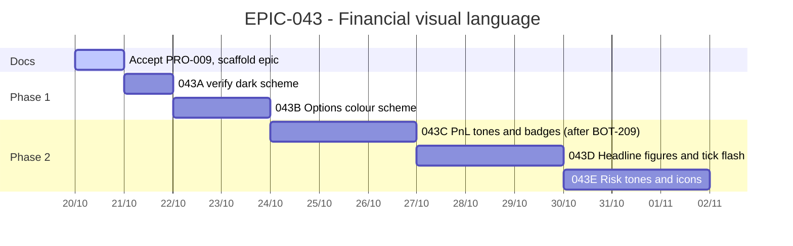

# EPIC-043 — Tracking

- **Epic:** [README](README.md)
- **Status:** 🟡 In Progress
- **Target Completion:** not set; `043C` waits for `BOT-209`
- **Renders:** GitHub Markdown, VS Code Mermaid preview, or mermaid.live.

---

## 1. Schedule (Gantt)

---

## 2. Sub-tasks & PR Matrix
| Id | Sub-task | Branch / PR | Risk | Status | Target / Merged |
| :--- | :--- | :--- | :-: | :--- | :--- |
| EPIC-043A | Verify the dark scheme | `claude/epic-043a-verify-dark-scheme` | 🟢 | 🟡 Pull request open | 2026-10-20 |
| EPIC-043B | Options colour scheme | not yet | 🟡 | 🔵 Planned | — |
| EPIC-043C | PnL tones and state badges | not yet | 🟡 | 🔵 Planned | — |
| EPIC-043D | Headline figures and tick flash | not yet | 🟡 | 🔵 Planned | — |
| EPIC-043E | Risk tones and icons | not yet | 🟡 | 🔵 Planned | — |

---

## 3. Milestone & Status Log
| Date | Item | Event & Outcome |
| :--- | :--- | :--- |
| 2026-10-20 | Spec | PRO-009 accepted by the owner; epic scaffolded. |
| 2026-10-20 | 043A | Every mode verified in dark; `setColorScheme` not effective off Windows or macOS. |

---

## 4. Blockers & Dependencies
| Blocker / Dependency | Impacted Tasks | Resolution / Owner | Status |
| :--- | :--- | :--- | :--- |
| BOT-209 (Bots Plan dock rework) must merge | EPIC-043C | The coordinator tells the author session when it has | 🟡 Open |
