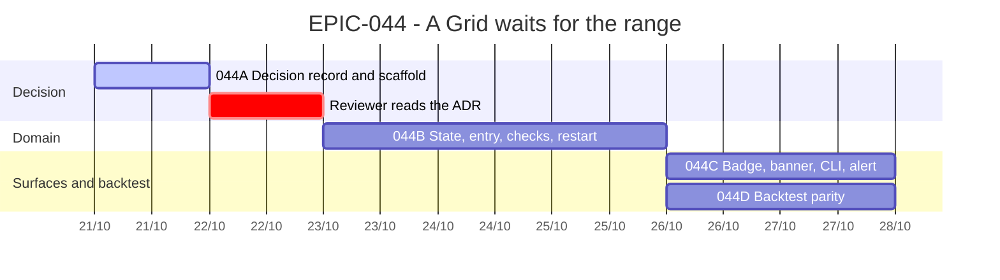

# EPIC-044 — Tracking

- **Epic:** [EPIC-044](README.md)
- **Status:** 🟡 In Progress (phase 2)
- **Target Completion:** 2026-10-28
- **Renders:** GitHub Markdown, VS Code Mermaid preview, or mermaid.live.

---

## 1. Schedule (Gantt)

---

## 2. Sub-tasks & PR Matrix

| Id | Sub-task | Branch / PR | Risk | Status | Target / Merged |
| :--- | :--- | :--- | :-: | :--- | :--- |
| EPIC-044A | [Decision record](completed/EPIC-044A_the_decision_record.md) | `claude/epic-044-grid-waits-for-the-range` | 🟢 | ✅ Merged (#679) | 2026-10-21 |
| EPIC-044B | [State and entry](completed/EPIC-044B_the_state_and_the_entry.md) | `claude/epic-044b-awaiting-range` | 🔴 | ✅ Merged (#682) | 2026-10-21 |
| EPIC-044C | [Surfaces](completed/EPIC-044C_the_waiting_bot_is_shown_and_told.md) | `claude/epic-044c-waiting-in-the-ui` | 🟡 | ✅ Merged (#686) | 2026-10-21 |
| EPIC-044D | [Backtest](completed/EPIC-044D_the_backtest_waits_the_same_way.md) | `claude/epic-044d-backtest-waits` | 🟡 | ✅ Merged (#687) | 2026-10-21 |

---

## 3. Milestone & Status Log

| Date | Item | Event & Outcome |
| :--- | :--- | :--- |
| 2026-10-21 | Spec | Epic scaffolded; the ADR written from the owner's rule and a probe of master. |
| 2026-10-21 | 044A | The ADR passed review in three rounds; D2–D12 accepted. |
| 2026-10-21 | 044C | Merged (#686): the sentence on the Plan, `bot list`/`bot show`, the heartbeat, `[health]`, one INFO alert on entry. |
| 2026-10-21 | 044D | Merged (#687): the replay waits and enters on the first step that closes inside the range; replay and live agree on the entry step. |
| 2026-10-21 | EPIC-044 | Done: the Futures restart on the VPS verified by the owner's `bot list`/`bot show` after #680. |
| 2026-10-21 | 044B | Merged (#682) after three review rounds: the state, the entry, the informational checks, the restart row. |

---

## 4. Blockers & Dependencies

| Blocker / Dependency | Impacted Tasks | Resolution / Owner | Status |
| :--- | :--- | :--- | :--- |
| Reviewer's read of the ADR | 044B | Reviewer PASS round 3; the coordinator accepted D2–D12 | ✅ Resolved |
| Owner questions O1–O3 (ADR §4) | 044B, 044D | Answered as recommended, 2026-10-21 | ✅ Resolved |
| Bug: Futures `bot resume` after a host restart refused "unexpected open positions" | 044B (Futures restart test) | `BUG-250` fixed (#680); verified on the VPS by the owner, 2026-10-21 | ✅ Resolved |
| `#677`, `#678`, `#674` merge | 044C | Not needed: the coordinator allowed the start; 044C merged as #686 | ✅ Resolved |
