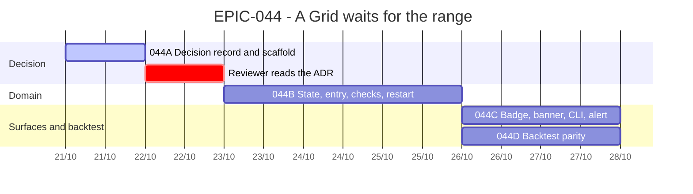

# EPIC-044 — Tracking

- **Epic:** [EPIC-044](README.md)
- **Status:** 🟡 In Progress
- **Target Completion:** 2026-10-28
- **Renders:** GitHub Markdown, VS Code Mermaid preview, or mermaid.live.

---

## 1. Schedule (Gantt)

---

## 2. Sub-tasks & PR Matrix

| Id | Sub-task | Branch / PR | Risk | Status | Target / Merged |
| :--- | :--- | :--- | :-: | :--- | :--- |
| EPIC-044A | [Decision record](incomplete/EPIC-044A_the_decision_record.md) | `claude/epic-044-grid-waits-for-the-range` | 🟢 | 🟡 Active | 2026-10-22 |
| EPIC-044B | [State and entry](incomplete/EPIC-044B_the_state_and_the_entry.md) | — | 🔴 | 🔵 Planned | 2026-10-25 |
| EPIC-044C | [Surfaces](incomplete/EPIC-044C_the_waiting_bot_is_shown_and_told.md) | — | 🟡 | 🔵 Planned | 2026-10-27 |
| EPIC-044D | [Backtest](incomplete/EPIC-044D_the_backtest_waits_the_same_way.md) | — | 🟡 | 🔵 Planned | 2026-10-27 |

---

## 3. Milestone & Status Log

| Date | Item | Event & Outcome |
| :--- | :--- | :--- |
| 2026-10-21 | Spec | Epic scaffolded; the ADR written from the owner's rule and a probe of master. |

---

## 4. Blockers & Dependencies

| Blocker / Dependency | Impacted Tasks | Resolution / Owner | Status |
| :--- | :--- | :--- | :--- |
| Reviewer's read of the ADR | 044B | Reviewer session, then the coordinator | 🟡 Open |
| Owner questions O1–O3 (ADR §4) | 044B, 044D | The coordinator relays to the owner | 🟡 Open |
| `#677`, `#678`, `#674` merge | 044C | The coordinator sequences | 🟡 Open |
