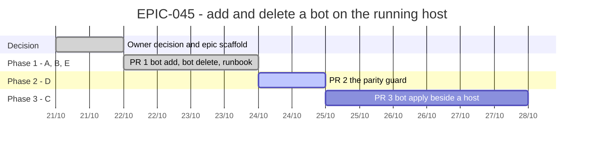

# EPIC-045 — Tracking

- **Epic:** [README](README.md)
- **Status:** ✅ Done (2026-10-22)
- **Target Completion:** 2026-10-28

---

## 1. Schedule (Gantt)

---

## 2. Sub-tasks & PR Matrix

| Id | Sub-task | Branch / PR | Risk | Status | Target / Merged |
| :--- | :--- | :--- | :-: | :--- | :--- |
| EPIC-045A | `bot add` | `claude/epic-045-runtime-bot-add-delete` (#692) | 🟡 | ✅ Merged | 2026-10-21 |
| EPIC-045B | `bot delete` | `claude/epic-045-runtime-bot-add-delete` (#692) | 🟡 | ✅ Merged | 2026-10-21 |
| EPIC-045E | Runbook | `claude/epic-045-runtime-bot-add-delete` (#692) | 🟢 | ✅ Merged | 2026-10-21 |
| EPIC-045F | `--start-planned` skips an unconfirmed mainnet bot | `claude/epic-045f-start-planned-skips-unconfirmed` (#694) | 🟡 | ✅ Merged | 2026-10-21 |
| EPIC-045D | Parity guard | `claude/epic-045d-tab-host-parity` (#697) | 🟢 | ✅ Merged on merge | 2026-10-22 |
| EPIC-045G | The four tab actions the host cannot do yet | `claude/epic-045g1-move-a-draft-to-another-venue` (#705), `claude/epic-045g2-confirm-resume` (#708), `claude/epic-045g3-arm-disarm` | 🔴 | ✅ Merged on merge | 2026-10-21 |
| EPIC-045C | `bot apply` beside a host | `claude/epic-045c-apply-beside-a-host` (#717) | 🔴 | ✅ Merged | 2026-10-22 |

---

## 3. Milestone & Status Log

| Date | Item | Event & Outcome |
| :--- | :--- | :--- |
| 2026-10-21 | Spec | Epic scaffolded; decision record written; A, B, E begun. |
| 2026-10-21 | PR #694 | Merged (85e77bb): `--start-planned` skips an unconfirmed mainnet bot; gate green, reviewer round 2 PASS. |
| 2026-10-22 | PR #717 | Merged (ae798da): `bot apply` beside a running host, entry by entry; gate green on f045fbad, reviewer round 3 PASS. Epic done, 7 of 7. |
| 2026-10-21 | PR #692 | Merged (b4127df): `bot add`, `bot delete`, runbook; gate green, reviewer round 3 PASS. |

---

## 4. Blockers & Dependencies

| Blocker / Dependency | Impacted Tasks | Resolution / Owner | Status |
| :--- | :--- | :--- | :--- |
| Delete's exposure rule is stricter than the tab's (D4) | B | accepted by the owner, 2026-10-21 | ✅ Resolved |
