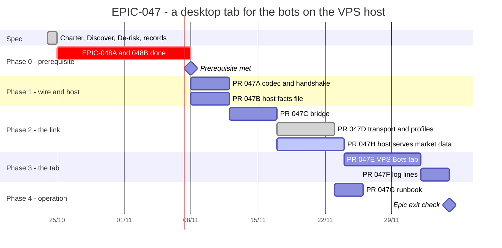

# EPIC-047 — Tracking

- **Epic:** [README](README.md)
- **Status:** 🟡 In progress (4/8) — resumed 2026-10-26; 047H added 2026-10-27, in review
- **Target Completion:** 2026-12-19
- **Renders:** GitHub Markdown, VS Code Mermaid preview, or mermaid.live.

---

## 1. Schedule (Gantt)

---

## 2. Sub-tasks & PR Matrix

| Id | Sub-task | Branch / PR | Risk | Status | Target / Merged |
| :--- | :--- | :--- | :-: | :--- | :--- |
| EPIC-047A | [Wire codec and version handshake](completed/EPIC-047A_the_wire_codec_and_the_version_handshake.md) | `claude/epic-047a-wire-codec` | 🟡 | ✅ Done (2026-10-26) | 2026-10-26 |
| EPIC-047B | [The host writes its in-memory facts](completed/EPIC-047B_the_host_writes_its_in_memory_facts_to_a_file.md) | `claude/epic-047b-host-facts-file` (#738) | 🔴 | ✅ Done (2026-10-27) | 2026-10-27 |
| EPIC-047C | [The bridge](completed/EPIC-047C_the_bridge_behind_a_forced_command.md) | `claude/epic-047c-bridge` (#739) | 🔴 | ✅ Done (2026-10-27) (VPS run pending) | 2026-11-19 |
| EPIC-047D | [Transport, profiles, Options page](completed/EPIC-047D_the_desktop_transport_profiles_and_the_options_page.md) | `claude/epic-047d-desktop-transport` (#744) | 🟡 | ✅ Done (2026-10-27) (owner measurements pending) | 2026-10-27 |
| EPIC-047H | [The host serves market data and refreshed facts](incomplete/EPIC-047H_the_host_serves_market_data_and_refreshed_facts_to_the_bridge.md) | `claude/epic-047h-host-market-data` | 🔴 | 🟡 In review (assumptions A1–A10 verified first; VPS measurements are the owner's) | 2026-10-27 |
| EPIC-047E | [The VPS Bots tab](incomplete/EPIC-047E_the_vps_bots_tab.md) | `claude/epic-047e-vps-tab` (PR 2 of 3) | 🔴 | 🟡 PR 2 of 3 in review (PR 1 merged, #749) | 2026-12-08 |
| EPIC-047F | [Log lines in the tab](incomplete/EPIC-047F_the_bots_log_lines_in_the_tab.md) | `Not opened` | 🟢 | 🔵 Planned | 2026-12-12 |
| EPIC-047G | [The runbook](incomplete/EPIC-047G_the_runbook_for_the_vps_link.md) | `Not opened` | 🟢 | 🔵 Planned | 2026-12-01 |

---

## 3. Milestone & Status Log

| Date | Item | Event & Outcome |
| :--- | :--- | :--- |
| 2026-10-24 | Spec | Charter v0.5, Discover v0.2 and De-risk v0.3 moved here; two decision records and seven children written. |
| 2026-10-25 | Epic | Paused by the owner; nothing built. See the README's Resume section. |
| 2026-10-26 | EPIC-047A | The wire codec, a contract test per root (14 roots, 47 records, 230 fields) and the version handshake are built; the per-bot revision rule is a gate, and the revision's source is left to 047C (task notes). |
| 2026-10-26 | Epic | Resumed by the owner. 047A and 047B run in parallel (neither needs the other); 047C waits for both; EPIC-048B's second pull request is taken up when 047E needs it. |
| 2026-10-26 | EPIC-047B | Branch `claude/epic-047b-host-facts-file`: the host writes `state/host-facts.json` on a change and at a 15 s heartbeat, owner-only and atomically, from a worker thread; tested on the composed app over the fake exchange. In review. |
| 2026-10-27 | EPIC-047B | Merged (#738): the host's facts file. Done. |
| 2026-10-27 | Epic | The owner's rule that the VPS tab connects to nothing at Binance. Charter v0.6, a decision record (host fetches, bridge reads; recorder; bounded refresh; offline; guard) and child 047H; 047E depends on 047D and 047H. Documentation only. |
| 2026-10-27 | EPIC-047D | Merged (#744): the desktop transport on `asyncssh`, connection profiles and the VPS Link options page. Done; the Windows agent login and the real-link reconnect time are the owner's. |
| 2026-10-27 | EPIC-047H | Branch `claude/epic-047h-host-market-data`: assumptions A1–A10 verified first (testnet and code); the recorder, the refresh under a weight ceiling, `bot refresh-facts`, the bridge's read side and the candle call. In review; the VPS measurements wait for the owner. |
| 2026-10-27 | EPIC-047C | Branch `claude/epic-047c-bridge`: the bridge (`sew-bridge`, `link_bridge_main`), its protocol and watchdog, the per-bot revision (own counter), `IHostFactsCodec.decode`, `IVenueKeyStates`, the request-id replay in `DirectoryHostControl`. Seven of nine criteria proved; the restricted key and the VPS import time are the owner's run. In review. |

---

## 4. Blockers & Dependencies

| Blocker / Dependency | Impacted Tasks | Resolution / Owner | Status |
| :--- | :--- | :--- | :--- |
| [EPIC-048](../EPIC-048_ui_reaches_the_application_through_its_doors/README.md) children A and B | every child | The guard holds for the Bots screen | 🟡 Open |
| Windows agent login untested (De-risk §3.8) | EPIC-047D | A run on the owner's machine with the key loaded into Pageant or the OpenSSH agent | 🟡 Open |
| A key restricted to the bridge in `sew`'s `authorized_keys` | EPIC-047C, 047G | The owner runs 047C's "Owner step" on the VPS (and 047G writes the permanent runbook) | 🟡 Open |
| Assumptions A1–A10 of the [2026-10-27 record](DECISION_2026-10-27_a_vps_bot_reaches_binance_only_through_the_vps.md) §6 (public streams cost no REST weight, the venue limits, the host's stream, per-read weight, the file-tail load, the exit reserve on the VPS) | EPIC-047H, 047E (market data, fresh facts) | Verified by 047H as far as testnet and the code allow (its "Step one"); the VPS rows (limits, stream log, `sew` read access, tail load, a day of headers) are the owner's run | 🟡 Open (owner) |
| 047C merged | EPIC-047H | 047H extends the bridge 047C builds | ✅ Met (#739) |
| The `asyncssh` dependency | EPIC-047D | Approved by the owner on 2026-10-27; merged in #744 | ✅ Met |
