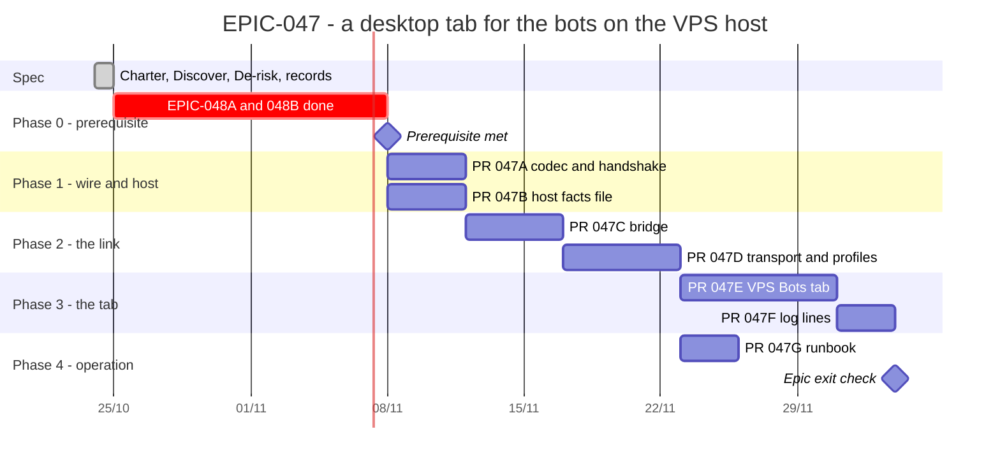

# EPIC-047 — Tracking

- **Epic:** [README](README.md)
- **Status:** 🟡 In progress (0/7) — resumed 2026-10-26
- **Target Completion:** 2026-12-19
- **Renders:** GitHub Markdown, VS Code Mermaid preview, or mermaid.live.

---

## 1. Schedule (Gantt)

---

## 2. Sub-tasks & PR Matrix

| Id | Sub-task | Branch / PR | Risk | Status | Target / Merged |
| :--- | :--- | :--- | :-: | :--- | :--- |
| EPIC-047A | [Wire codec and version handshake](incomplete/EPIC-047A_the_wire_codec_and_the_version_handshake.md) | `Not opened` | 🟡 | 🔵 Planned | 2026-11-12 |
| EPIC-047B | [The host writes its in-memory facts](incomplete/EPIC-047B_the_host_writes_its_in_memory_facts_to_a_file.md) | `Not opened` | 🔴 | 🔵 Planned | 2026-11-12 |
| EPIC-047C | [The bridge](incomplete/EPIC-047C_the_bridge_behind_a_forced_command.md) | `Not opened` | 🔴 | 🔵 Planned | 2026-11-19 |
| EPIC-047D | [Transport, profiles, Options page](incomplete/EPIC-047D_the_desktop_transport_profiles_and_the_options_page.md) | `Not opened` | 🟡 | 🔵 Planned | 2026-11-27 |
| EPIC-047E | [The VPS Bots tab](incomplete/EPIC-047E_the_vps_bots_tab.md) | `Not opened` | 🔴 | 🔵 Planned | 2026-12-08 |
| EPIC-047F | [Log lines in the tab](incomplete/EPIC-047F_the_bots_log_lines_in_the_tab.md) | `Not opened` | 🟢 | 🔵 Planned | 2026-12-12 |
| EPIC-047G | [The runbook](incomplete/EPIC-047G_the_runbook_for_the_vps_link.md) | `Not opened` | 🟢 | 🔵 Planned | 2026-12-01 |

---

## 3. Milestone & Status Log

| Date | Item | Event & Outcome |
| :--- | :--- | :--- |
| 2026-10-24 | Spec | Charter v0.5, Discover v0.2 and De-risk v0.3 moved here; two decision records and seven children written. |
| 2026-10-25 | Epic | Paused by the owner; nothing built. See the README's Resume section. |
| 2026-10-26 | Epic | Resumed by the owner. 047A and 047B run in parallel (neither needs the other); 047C waits for both; EPIC-048B's second pull request is taken up when 047E needs it. |

---

## 4. Blockers & Dependencies

| Blocker / Dependency | Impacted Tasks | Resolution / Owner | Status |
| :--- | :--- | :--- | :--- |
| [EPIC-048](../EPIC-048_ui_reaches_the_application_through_its_doors/README.md) children A and B | every child | The guard holds for the Bots screen | 🟡 Open |
| Windows agent login untested (De-risk §3.8) | EPIC-047D | A run on the owner's machine with the key loaded into Pageant or the OpenSSH agent | 🟡 Open |
| A key restricted to the bridge in `sew`'s `authorized_keys` | EPIC-047C, 047G | The owner installs it from the runbook | 🟡 Open |
| The `asyncssh` dependency | EPIC-047D | Named in the pull request body; the owner may veto before merge | 🟡 Open |
