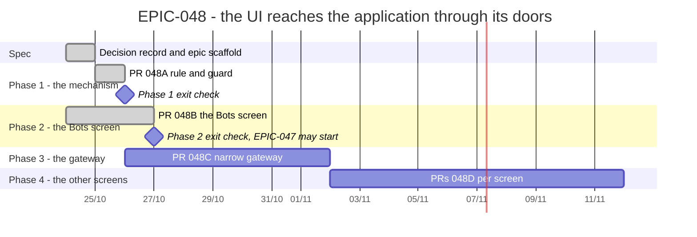

# EPIC-048 — Tracking

- **Epic:** [README](README.md)
- **Status:** 🟡 In progress, 2/4 — 048A and 048B done (048B on 2026-10-27); 048C and 048D stay paused
- **Target Completion:** 2026-11-21
- **Renders:** GitHub Markdown, VS Code Mermaid preview, or mermaid.live.

---

## 1. Schedule (Gantt)

---

## 2. Sub-tasks & PR Matrix

| Id | Sub-task | Branch / PR | Risk | Status | Target / Merged |
| :--- | :--- | :--- | :-: | :--- | :--- |
| EPIC-048A | [Rule and guard](completed/EPIC-048A_the_doors_rule_and_its_guard.md) | `claude/epic-048a-doors-guard` | 🟡 | ✅ Done (2026-10-24) | 2026-10-28 |
| EPIC-048B | [The Bots screen through the doors](completed/EPIC-048B_the_bots_screen_through_the_doors.md) | PR 1 [#731](https://github.com/anhembedded/Sagittarius_Elite_Warrior/pull/731) merged 2026-10-25; PR 2 `claude/epic-048b-pr2-bots-screen-reads` | 🔴 | ✅ Done (2026-10-27) | 2026-11-03 |
| EPIC-048C | [A narrow gateway for presenters](incomplete/EPIC-048C_presenters_receive_a_narrow_gateway.md) | `Not opened` | 🟡 | 🔵 Planned | 2026-11-04 |
| EPIC-048D | [The other screens](incomplete/EPIC-048D_the_other_screens_cut_down_to_the_baseline.md) | `Not opened` | 🟡 | 🔵 Planned | 2026-11-21 |

---

## 3. Milestone & Status Log

| Date | Item | Event & Outcome |
| :--- | :--- | :--- |
| 2026-10-24 | EPIC-048A | Rule and guard done; baseline 197 imports in 73 files over 16 areas, 30 container-taking functions, measured at `96cb27c`. |
| 2026-10-24 | Spec | Epic scaffolded with the G9 decision record and four children. |
| 2026-10-25 | Epic | Paused by the owner; 048B's first pull request (#731) merged, the rest waits. See the README's Resume section. |
| 2026-10-26 | Epic | The owner resumed EPIC-047; this epic continues only with 048B's second pull request, when 047E needs it. 048C and 048D stay paused. |
| 2026-10-27 | EPIC-048B | Second pull request: the venues, the export and the tables' sizes off the UI thread and behind the doors; the guard reads ADAPTER 0, PORT 4, data 0 for the Bots screen. 048B done; EPIC-047 may start. |

---

## 4. Blockers & Dependencies

| Blocker / Dependency | Impacted Tasks | Resolution / Owner | Status |
| :--- | :--- | :--- | :--- |
| EPIC-047 waits on this epic | [EPIC-047](../EPIC-047_vps_bots_tab/README.md) (every child) | 048A and 048B done | ✅ Closed (2026-10-27) |
