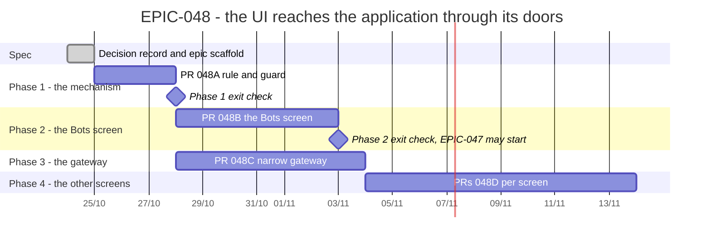

# EPIC-048 — Tracking

- **Epic:** [README](README.md)
- **Status:** 🔵 Planned
- **Target Completion:** 2026-11-21
- **Renders:** GitHub Markdown, VS Code Mermaid preview, or mermaid.live.

---

## 1. Schedule (Gantt)

---

## 2. Sub-tasks & PR Matrix

| Id | Sub-task | Branch / PR | Risk | Status | Target / Merged |
| :--- | :--- | :--- | :-: | :--- | :--- |
| EPIC-048A | [Rule and guard](incomplete/EPIC-048A_the_doors_rule_and_its_guard.md) | `Not opened` | 🟡 | 🔵 Planned | 2026-10-28 |
| EPIC-048B | [The Bots screen through the doors](incomplete/EPIC-048B_the_bots_screen_through_the_doors.md) | `Not opened` | 🔴 | 🔵 Planned | 2026-11-03 |
| EPIC-048C | [A narrow gateway for presenters](incomplete/EPIC-048C_presenters_receive_a_narrow_gateway.md) | `Not opened` | 🟡 | 🔵 Planned | 2026-11-04 |
| EPIC-048D | [The other screens](incomplete/EPIC-048D_the_other_screens_cut_down_to_the_baseline.md) | `Not opened` | 🟡 | 🔵 Planned | 2026-11-21 |

---

## 3. Milestone & Status Log

| Date | Item | Event & Outcome |
| :--- | :--- | :--- |
| 2026-10-24 | Spec | Epic scaffolded with the G9 decision record and four children. |

---

## 4. Blockers & Dependencies

| Blocker / Dependency | Impacted Tasks | Resolution / Owner | Status |
| :--- | :--- | :--- | :--- |
| EPIC-047 waits on this epic | [EPIC-047](../EPIC-047_vps_bots_tab/README.md) (every child) | 048A and 048B done | 🟡 Open |
